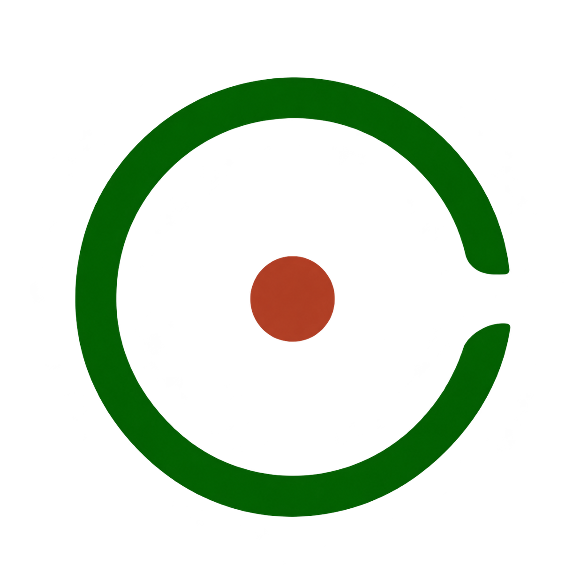

<p align="center">
  
</p>

# Retinal Review Workbench

A clinician-controlled workspace for diabetic retinopathy (DR) screening, image review and research dataset
preparation. Reviewers confirm each image, choose the final DR grade, mark lesions and write the screening
report. AI (RETFound and USPEC for grading, PRISM for lesion boxes) is optional assistance; the person's
decision is always authoritative.

**Not a diagnostic device.** This is a research and clinician-support proof of concept. It makes no claim of
autonomous diagnosis or referral, clinical validation or calibrated probabilities.

## Quick start

### Clinic users (no code)

On a Windows PC with Docker Desktop running, double-click **`SETUP_WEB_APP.bat`** once. It asks two
questions (image folder, AI server address or Enter for none), creates the private settings with random
passwords, starts the app, asks for the first administrator account and puts a **DR Screening Web App**
button on the desktop. After that, use the desktop button; the app opens at `https://localhost/app/`.
Without an AI server the app works for manual review.

The live AI demo runs from the project owner's workstation (desktop button **DR Screening Demo**) because it
needs access to the team AI server. Only public or consented images are sent there.

A step-by-step Thai user manual with screenshots will be in `docs/pdfs/USER_MANUAL_TH.pdf`.

### Hospital IT

Everything inside the hospital network (web app, PostgreSQL, model gateway, the three GPU model services and
an HTTPS front) runs from [`deployment/hospital-server`](deployment/hospital-server/README.md) on a Linux GPU
server. The web app alone is [`deployment/webapp`](deployment/webapp/README.md). No weights, data or secrets
are inside the images. The hospital package has not yet run on a hospital GPU server.

### Developers

```powershell
git clone https://github.com/siriponsri/dr-support-screening-poc.git
cd dr-support-screening-poc
uv sync --python 3.12 --extra test --extra dicom --extra browser-test
npm.cmd ci
cd frontend; npm.cmd ci; npm.cmd run build; cd ..

.\.venv\Scripts\python.exe -m pytest -q                      # backend (offline, models mocked)
.\.venv\Scripts\python.exe -m ruff check dr_support tests
cd frontend; npm.cmd test; npm.cmd run typecheck; cd ..      # frontend
npm.cmd test                                                 # root smoke tests
.\.venv\Scripts\python.exe scripts\docs\check_docs.py        # docs links
```

Read [`AGENTS.md`](AGENTS.md) (binding rules: branches, worktrees, merge gate), then
[`docs/ARCHITECTURE.md`](docs/ARCHITECTURE.md) and [`HANDOFF.md`](HANDOFF.md). Never commit protected health
information, secrets, model weights, runtime databases or `local-state/` contents.

## Documentation

See the [documentation portal](docs/README.md). Licence: [LICENSE](LICENSE); third-party terms:
[THIRD_PARTY_NOTICES.md](THIRD_PARTY_NOTICES.md). Visual rules: [DESIGN.md](DESIGN.md).
