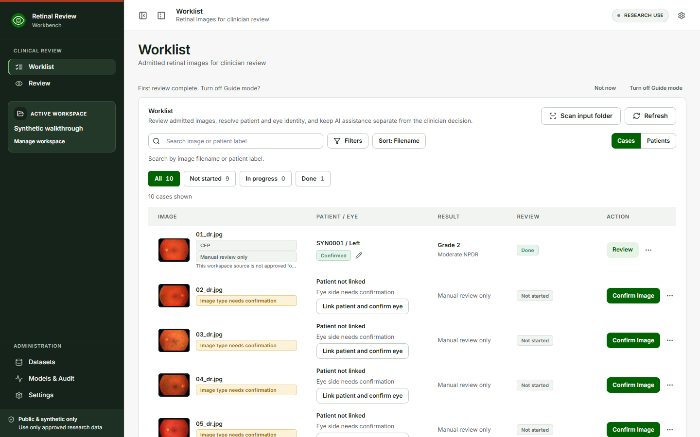
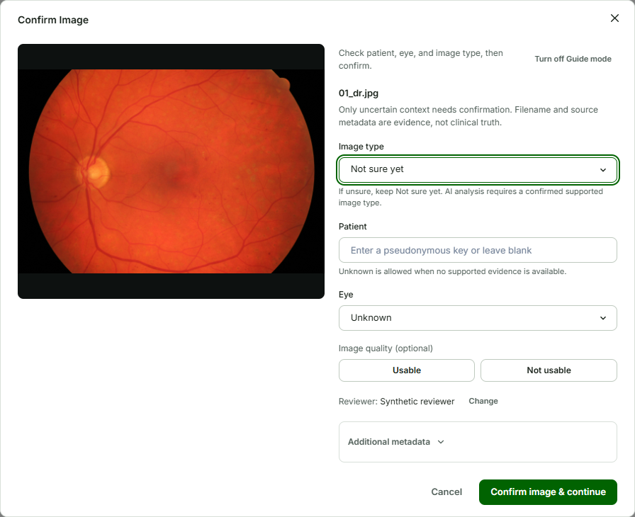

# Worklist and Confirm Image {#sec-worklist}

## Open the Worklist

**Purpose.** Start a review session in the approved Workspace.

**Steps.**

1. Start the workstation with the launcher provided by your operator and open `http://127.0.0.1:8000/app/`.
2. Check that the sidebar shows the correct **Active workspace**. If not, open **Settings** and select it.
3. In **Worklist**, choose **Scan input folder** when new images have been added.

**Expected result.** Each admitted image appears as one row with the columns **Image**, **Patient / eye**, **Result**, **Review**, and **Action**. Source files are never moved or changed.

{#fig-worklist width=100%}

## Find cases

The quick filter above the table has four chips, each with a count: **All**, **Not started**, **In progress**, and **Done**. When **Done** is selected, a second row labelled **Final grade** narrows the list to **All grades**, **Grade 0** to **Grade 4**, or **Ungradable**. The line below the chips reads **N cases shown**. Search, the filter button, **Sort**, and the **Cases** / **Patients** view switch sit above the chips.

| Column | What it shows |
|:-------|:--------------|
| **Result** | The clinician's final grade once it is recorded, for example **Grade 2** with *Moderate NPDR*, or **Ungradable**. Before that, only AI availability: **AI ready**, **AI not run yet**, **Confirm image type**, or **Manual only** / **Manual review only**. The AI grade is not shown here, so it does not anchor your review. |
| **Review** | **Not started**, **In progress**, or **Done**, with a short next step such as **Grade next**, **Findings next**, or **Needs Second Review**. An image is Done when the grade and findings are finished, or when it was confirmed Ungradable. |

: {tbl-colwidths="[18,82]"}

## Quick look

Click a row thumbnail to open **Quick look** without leaving the Worklist. It is view only: a large retinal image with **AI suggestions** and **Clinician findings** switches, the **Final DR grade**, **Findings**, **Reviewer**, and **Image type**. Choose **Open review** to work on the image, or **Close**. *Reviewed, none recorded* means the findings were reviewed; it does not mean lesions are absent.

```{=latex}
\Needspace{32\baselineskip}
```

## Confirm Image

**Purpose.** Confirm the image context before analysis or clinical review. This is the first confirmation milestone.

::::: {layout="[58,42]" layout-valign="top"}
:::: {}
**Steps.**

1. In the case row, choose **Confirm Image**. (After the first confirmation the row shows **Review**; **Confirm Image again** stays in the row menu **...**.)
2. Look at the retinal image beside the fields. A value already supported by evidence appears as a summary with its source, for example *suggested from filename*, and an **Edit** button. It remains a suggestion until you confirm.
3. Check **Image type**: **Conventional fundus photograph**, **Ultra-widefield**, or **Not sure yet**. If uncertain, keep **Not sure yet**; the clinician can still review the image, but AI analysis stays unavailable.
4. Check **Patient**. Enter a pseudonymous key, for example `PAT0001`, or leave it blank when the case should stay unlinked.
5. Check **Eye**: **Left**, **Right**, or **Unknown**.
6. Optional: under **Image quality (optional)**, choose **Usable** or **Not usable**.
7. Check the reviewer. The first time, enter your **Reviewer name**; **Use as default reviewer on this workstation** is already selected. Next time the dialog shows **Reviewer:** with your name and a **Change** button.
8. Choose **Confirm image & continue**.

**Expected result.** The image type, patient and eye context, reviewer, and timestamp are saved and **Review** opens for this image.
::::
:::: {}
{#fig-confirm-image width=100%}
::::
:::::

**Additional metadata** holds the optional visit key, capture date/time, capture sequence, and camera/device. Leaving **Image quality (optional)** empty records nothing; Review asks for image quality only before PRISM (@sec-review). If the image is confirmed but the quality choice could not be saved, the dialog stays open and says so. Choose **Save image quality** to try again, or **Continue without quality**.

Hospital workspaces show a short workspace label, such as **Patient 1**, instead of an internal identifier. The label is a navigation aid within this Workspace, not a verified real-world identity or a label to copy between Workspaces. The existing patient link is kept when you confirm unchanged context. To correct the assignment, use **Edit** beside **Patient** in Confirm Image, or **Edit patient / eye** in the row menu and then **Change patient link**. Enter an approved pseudonymous replacement, choose **Keep current patient link**, or choose **Leave this image unlinked**. You do not need to type a generated internal ID.

Filename or resolver suggestions are evidence only; nothing is inferred from a filename until you confirm it. A manual patient or eye value is never overwritten by a later automatic refresh. The remembered reviewer is a convenience and is not authentication.

## Admission exceptions

Use the row status to decide the next action. **Resolve image readiness** and **Exclude from queue** are available in the same row menu. A recognized MRI or other non-fundus DICOM stays **Unsupported modality** and is never sent to RETFound or PRISM-DR.

::: {.callout-important title="Important: source files"}
Do not rename, move, overwrite, or recompress admitted source images. The workstation records the original source identity and works from it.
:::

```{=latex}
\Needspace{40\baselineskip}
```
