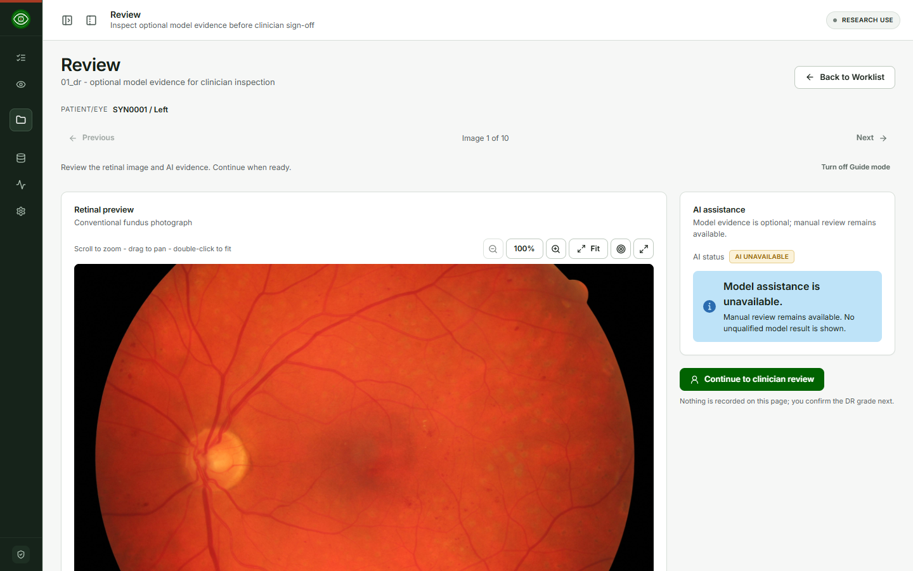
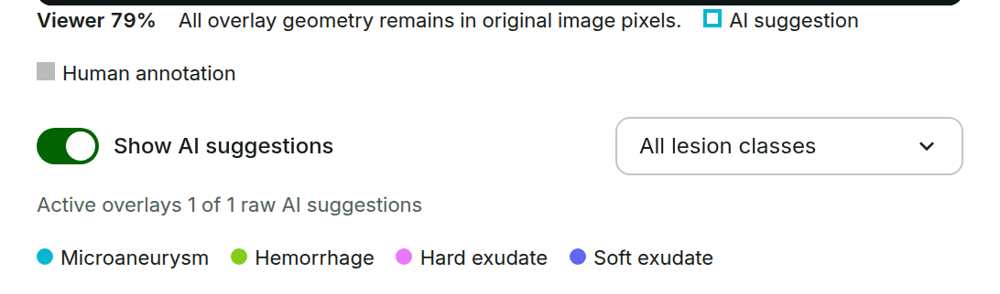

# Review and Optional AI Assistance {#sec-review}

## Inspect the image

**Purpose.** Inspect the retinal image and any optional model evidence before the grade decision. No clinical decision is recorded on this page.

{#fig-review width=90%}

**Steps.**

1. Review opens after **Confirm Image**. You can also open it with **Review** in a confirmed Worklist row.
2. Use the viewer controls to zoom, fit, pan, inspect coordinates, or open the full-screen view.
3. Check the **Patient/Eye** line above the image.
4. Choose **Analyze grading only** when offered for global grading. PRISM submission is paused until the server can bind a reviewed input preview. **Preview PRISM input** distinguishes the planned API submission from a conditional FOV candidate; native ROI is **NOT_RUN**, so the final internal crop is not previewed. If a bound preview is unavailable, continue with manual review. Other qualified non-PRISM assistance retains **Analyze**.

The workstation routes model assistance from the clinician-confirmed image type
and the live capability metadata. A ready global capability must advertise
`CFP` for CFP grading or `UWF` for UWF grading. `Other / Unknown` is
manual-only, and PRISM is lesion assistance rather than a DR grading model.
The Settings page shows the discovered task, modality, readiness, and release
state. AI availability never changes the clinician's final decision path.
5. Choose **Continue to clinician review**. This is the only forward action on Review.

For an **Ultra-widefield** image, Review remains available whether or not a
ready UWF capability is connected. The UI enables model assistance only when
the live metadata advertises a compatible ready capability. PRISM UWF lesion
assistance is experimental, was trained for CFP, and is **not validated for
UWF**. If PRISM reports that a trusted analysis field was used, **PRISM
analysis field** shows the same-size field evidence associated with that
inference. When processing falls back to the Original image, no PRISM boundary
is drawn; **Processing details** reports that fallback processing was used.
These are previous-run processing records, not a preview of the next request.
If native ROI fails, the baseline discards its FOV candidate and uses full Original.
FOV or native ROI preparation failure alone does not mean inference failed.
The mask is an engineering aid, not a diagnosis or a validated lesion
segmentation; human review remains authoritative.

**Expected result.** The retinal image stays the main surface. The right column shows **Analysis**, **DR assessment**, and **Lesion suggestions**. Annotation work is not started from Review; it follows the grade decision (@sec-annotations).

## Read the model suggestions

- **DR assessment** shows the RETFound grade suggestion and its model confidence. This is a model score, not a calibrated probability.
- **Lesion suggestions** counts PRISM-DR suggestions by class. An untouched overlay is labelled with class and score, for example `EX · 0.82`.
- The lesion summary is not a task list. You do not need to inspect every AI ROI.

## Show or filter the overlays

Use **Show AI suggestions** to show or hide the PRISM overlays, and the lesion filter to display **All lesion classes** or one class: **MA · Microaneurysm**, **HE · Hemorrhage**, **EX · Hard exudate**, or **SE · Soft exudate**. The counter shows how many raw AI suggestions are active.

{#fig-ai-controls width=80%}
