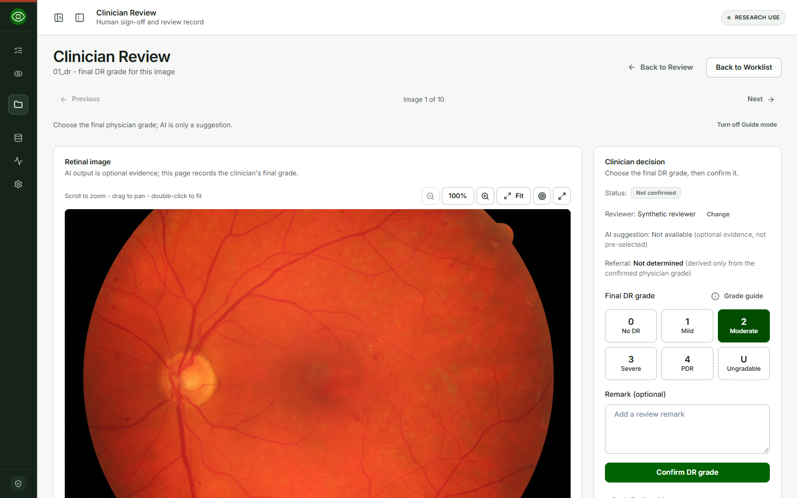
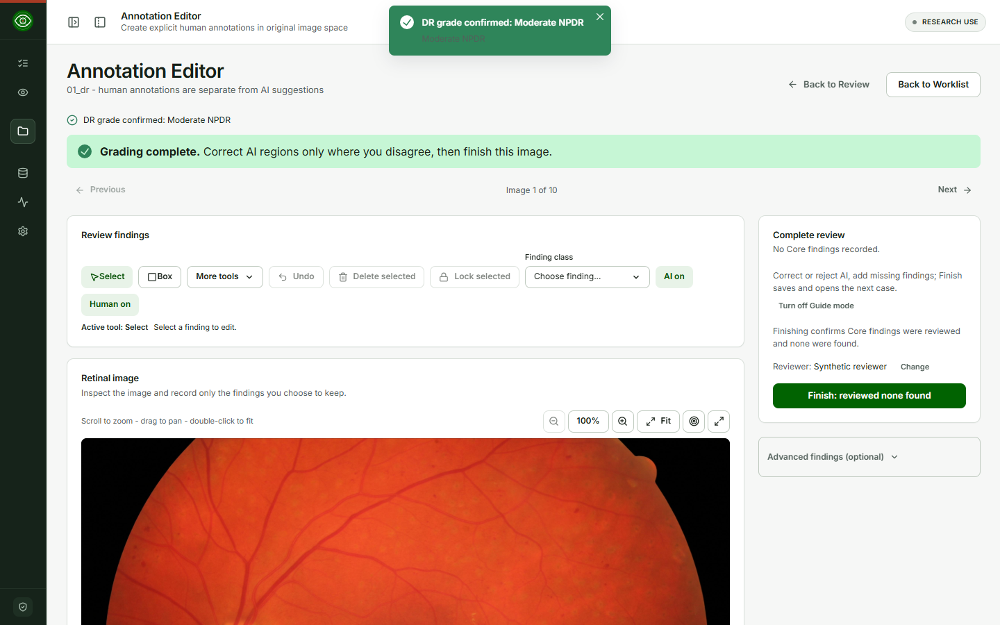
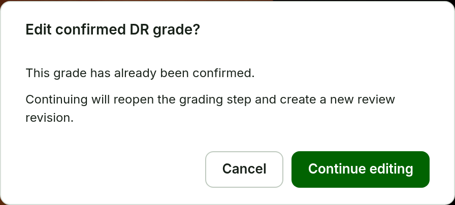

# Confirm DR Grade {#sec-grade}

**Purpose.** Record the clinician's final DR grade. This is the second confirmation milestone.

**Steps.**

1. From **Review**, choose **Continue to clinician review**.
2. Check **Status: Not confirmed** and the reviewer. A remembered reviewer shows as **Reviewer:** with your name and a **Change** button; otherwise enter your **Reviewer name**.
3. Read the **AI suggestion** line, if a suggestion exists. It is never pre-selected.
4. Under **Final DR grade**, click one button: **0** (No DR), **1** (Mild), **2** (Moderate), **3** (Severe), **4** (PDR), or **U** (Ungradable). A click only selects; nothing is recorded yet. **Grade guide** opens the grading reference.
5. Add a **Remark (optional)** when useful.
6. Choose **Confirm DR grade**, or **Confirm Ungradable** when Ungradable is selected. The button stays disabled until a choice is selected.

**Expected result.** *DR grade confirmed: Moderate NPDR* (with your grade) appears and the **Annotation Editor** opens for the same image, showing the same line and *Grading complete*. Keeping the model grade is recorded as `AI_ACCEPTED`, a different grade as `AI_CORRECTED`, and a grade without a model result as `MANUAL`. The human grade is the authoritative decision.

**Confirm Ungradable** records *Image marked Ungradable*. Ungradable is a separate image-review state, not a DR severity, and no DR grade is stored. The image counts as **Done** in the Worklist and the Annotation Editor does not open.

If you are not ready to decide, do not confirm; the grade simply stays *Not confirmed*. When the case needs a second reader, open **Can't finalize this case** and choose **Needs another review**. *Needs Second Review recorded* appears, the Worklist shows **Needs Second Review**, and the grade is later finished with **Resolve and confirm DR grade**. There is no separate senior-review action. Historical senior-review records from earlier versions remain readable and are labelled *Legacy senior-review record*.

::: {layout="[52,48]" layout-valign="top"}
{#fig-grade}

{#fig-grade-recorded}
:::

## Change a confirmed grade

Returning to a confirmed case shows **Grading complete** with the grade, reviewer, and confirmation time, plus **Continue to Annotation Editor**. To change the grade, choose **Edit confirmed grade**. One warning, *Edit confirmed DR grade?*, appears for this edit session:

{#fig-edit-grade width=52%}

Choose **Continue editing** to reopen the grade. The new confirmation creates a new review revision; the earlier decision stays in the review history.
