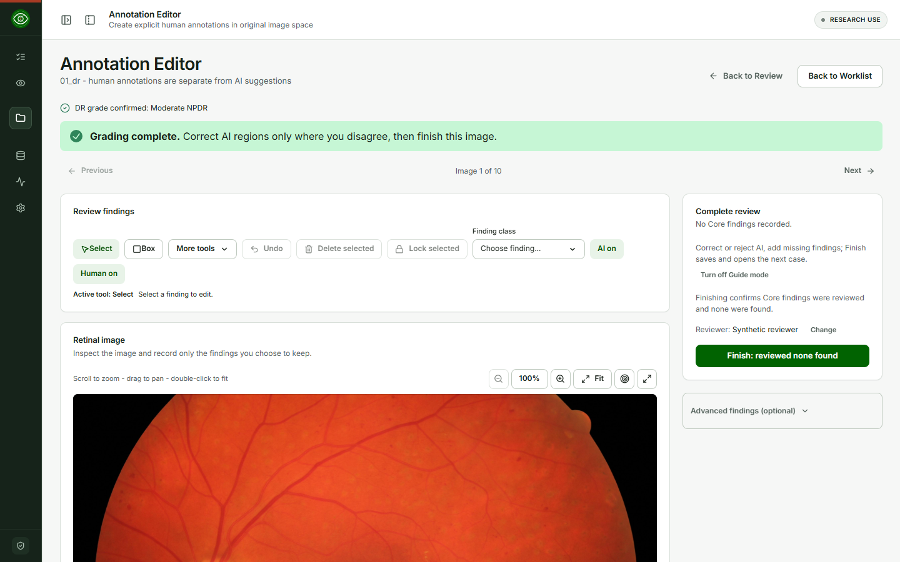
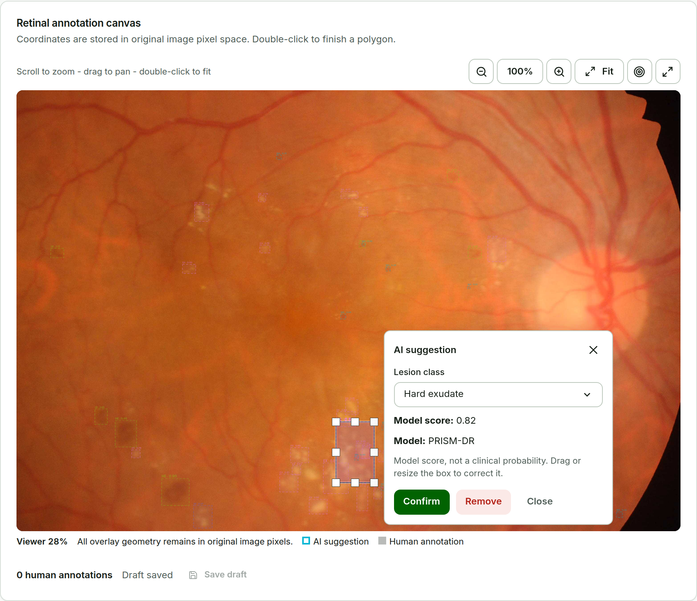
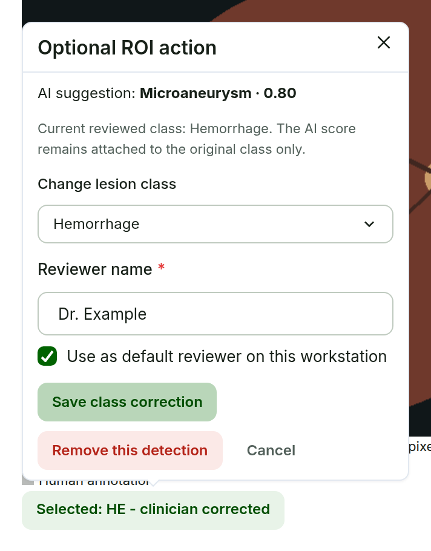

# Annotation Editor {#sec-annotations}

**Purpose.** Record human annotations only where you disagree with the AI suggestions or want to add a finding. The Annotation Editor opens automatically after **Confirm DR grade**.

AI suggestions are optional visual evidence. The normal workflow is image-first and **Box**-first: edit a region when you disagree with an AI suggestion or want to record a human annotation. The Finish button completes the Core review; it does not mean every AI ROI was individually verified. Untouched AI suggestions stay AI suggestions; they never become human labels by themselves. Advanced findings are optional and deferred.

{#fig-editor width=90%}

If an image is opened here before its grade is confirmed, *Confirm the DR grade first.* appears with **Open Clinician Review** and the Finish button stays disabled. Your draft is kept.

## Correct or remove an AI ROI

**Steps.**

1. Click an AI ROI on the image (inline or full-screen). It is highlighted, other ROIs dim, and the **AI suggestion** card opens beside it without covering it. Near the edge of the viewer the card moves to the other side or docks in a corner.
2. Read **Model score** and **Model: PRISM-DR**.
3. To change the class, choose it in **Lesion class**. The score line then reads *for AI class ...*: the score belongs to the model's class, not to your correction.
4. To change the box, drag it or drag a handle. The original AI box stays visible underneath.
5. Choose **Confirm** to record the ROI as a human annotation, **Remove** to remove it from the active reviewed result, or **Close** (or Escape) to leave without a change.

**Expected result.** *Annotation confirmed* or *AI suggestion removed* appears briefly and you stay on the image. A corrected ROI is labelled, for example, `EX: clinician corrected`, without a score; an untouched AI ROI keeps its class and score, for example `HE 0.55`; a human annotation is labelled, for example, `Human: HE`. The original AI class, score, geometry, and model identity stay in the review record; a removed suggestion stays in the audit record.

::: {layout="[[50,50]]" layout-valign="top"}
{#fig-roi}

{#fig-roi-corrected}
:::

::: {.callout-important title="Important: score meaning"}
A model score belongs to the class and box the model predicted. If PRISM suggests a hemorrhage with score 0.55 (`HE 0.55`) and you change the class to Hard exudate, the ROI reads `EX: clinician corrected`. It is never shown as `EX 0.55`.
:::

## Draw human annotations

Under **Review findings**, **Box** is the primary tool. Choose **Polygon**, **Point**, or **Circle** from **More tools** only when needed, select a **Finding class**, then draw. The compact toolbar keeps **Select**, **Box**, **Undo**, **Delete selected**, the finding class, and the **AI on** / **Human on** visibility buttons together; the active geometry tool shows its short drawing instruction. **Select**, **Undo**, **Delete selected**, and **Lock selected** adjust your own annotations. Human annotations are stored in original image pixels and remain separate from the AI evidence. Dense geometry work can use the optional CVAT round trip (@sec-cvat).

The same active tool label and drawing guidance remain visible inside the full-screen review surface; Escape closes an open **More tools** popup without exiting full-screen review.

The **Complete review** panel keeps the remembered reviewer and one forward action. With no Core human findings, the button reads **Finish: reviewed none found**, or **Finish: no findings added (N AI suggestions not accepted)** when AI suggestions exist. Either records deliberate review completeness; it does not create a negative lesion annotation. Advanced findings remain optional and deferred, and opening the optional explanation does not ask the clinician to manage an internal partial-review state.
