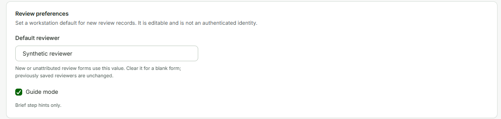
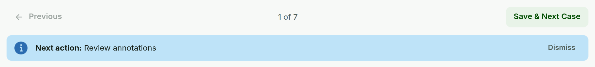
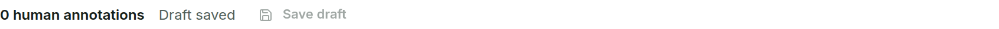

# Working Through Cases {#sec-repeated}

These conveniences reduce repetitive work. None of them confirms a milestone or changes clinical state on its own.

## Reviewer default {#sec-reviewer-default}

**Use as default reviewer on this workstation** is selected by default in reviewer fields, so the name you enter first is remembered. You can also set **Default reviewer** in **Settings**. Once a name is remembered, review forms show **Reviewer:** with the name and a **Change** button instead of an empty field.

{#fig-reviewer width=66%}

The value is stored only in this browser. It stays editable, it is not authentication, and it never rewrites reviewer names already recorded. On a shared workstation, use **Change** or update **Settings** when the user changes.

## Previous and Next

**Previous** and **Next** move through the Worklist order shown in the middle (for example `Image 1 of 4`). The other image opens at Review, or at Confirm Image if its context is not yet confirmed. Moving never saves a confirmation. While the current image is not complete, or has unsaved edits, one warning, *Switch to another image?*, appears for that switch:

{#fig-navigation width=52%}

Choose **Stay on this image** to continue, or **Switch image** to open the other image; the autosaved draft is kept. **Back to Worklist** on Clinician Review and Annotation Editor asks a similar *Leave this image?* question. A complete image switches without a warning.

## Autosave {#sec-autosave}

In the Annotation Editor, edits are saved in the background about one second after you stop editing, provided a reviewer name is entered. The status below the canvas shows **Saving...**, **Draft saved**, **Save failed**, or *Enter a reviewer name to save*. Leaving with unsaved edits asks *Save draft before leaving?* with **Save draft and leave**.

{#fig-draft width=68%}

A draft is not a confirmation; only the Finish button completes the image.

## Guide mode

With **Guide mode** on, a short hint at the top of each step suggests what to do, for example *Check patient, eye, and image type, then confirm.* It is guidance only. Choose **Turn off Guide mode** to hide the hints on this workstation; turn them back on with the **Guide mode** checkbox in **Settings**. After your first finished image, the hint area offers *First review complete. Turn off Guide mode?* with **Not now**.

```{=latex}
\Needspace{30\baselineskip}
```
