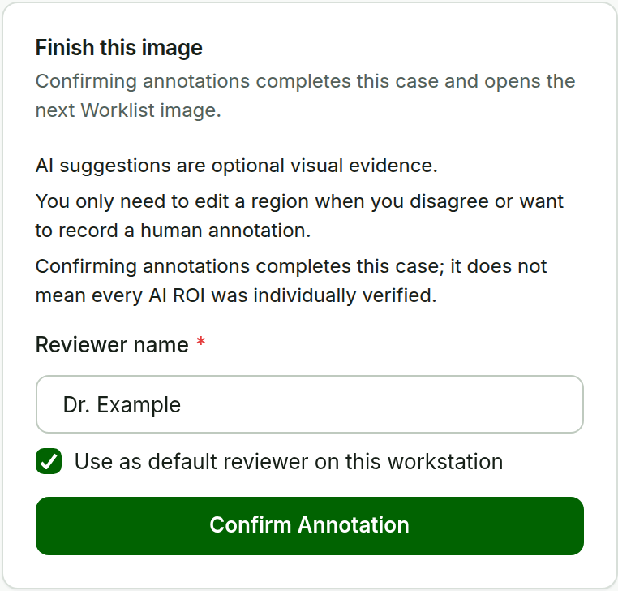
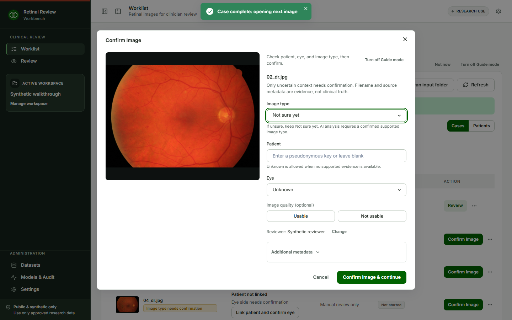
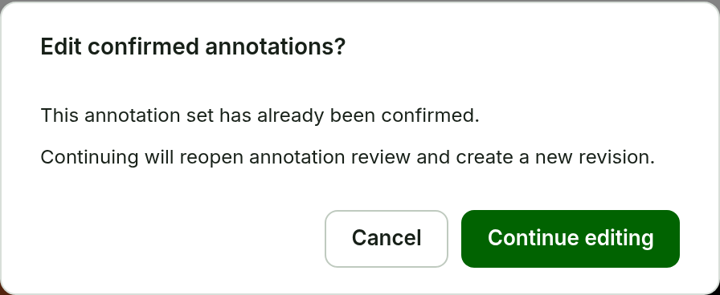

# Finish Image and Next {#sec-confirm-annotation}

**Purpose.** Finish this image. This is the third confirmation milestone.

::::: {layout="[50,50]" layout-valign="top"}
:::: {}
**Steps.**

1. Make any optional ROI changes. You do not need to inspect every AI ROI.
2. Check the reviewer in **Complete review**. The remembered
   reviewer is a convenience, not authentication.
3. Choose the Finish button. Its label tells you what will be recorded:
   **Finish image & next** when you recorded findings;
   **Finish: reviewed none found** when there are no findings and no AI
   suggestions; or **Finish: no findings added (N AI suggestions not
   accepted)** when AI suggestions exist but you added no findings.

**Expected result.** Any pending draft is saved, then Core completeness is
recorded deliberately, the internal annotation-confirmation milestone stores
the reviewer, timestamp, and hash of the active annotation set, and *Case
complete: opening next image* appears. The Worklist shows **Done**
for this image, and the next unfinished Worklist image opens (at Confirm
Image if its context is not yet confirmed). When every image is complete,
the message says so. Both no-findings labels store the same meaning, reviewed
none found (`REVIEWED_NONE_FOUND`). It is review-completeness evidence only; it does not create a
negative lesion annotation or authorize a Phase 4 negative export, and AI
suggestions you did not accept are not recorded as findings.
::::
:::: {}
{#fig-confirm-annotation width=100%}
::::
:::::

{#fig-case-complete width=90%}

## Change confirmed annotations

When the annotations of an image are confirmed, the editor shows an **Annotations confirmed** box with the reviewer and time, and the editor is read-only. The box does not appear before that. Choose **Edit confirmed annotations** (or click an AI ROI) to reopen it; one warning, *Edit confirmed annotations?*, appears per edit session. **Open next image** moves on without changes. Any later edit changes the hash, so the image needs the Finish button again before it is Lesion-ready.

{#fig-edit-annotations width=52%}

Confirming an empty set is allowed; it records that the set was reviewed, not that lesions are absent.
