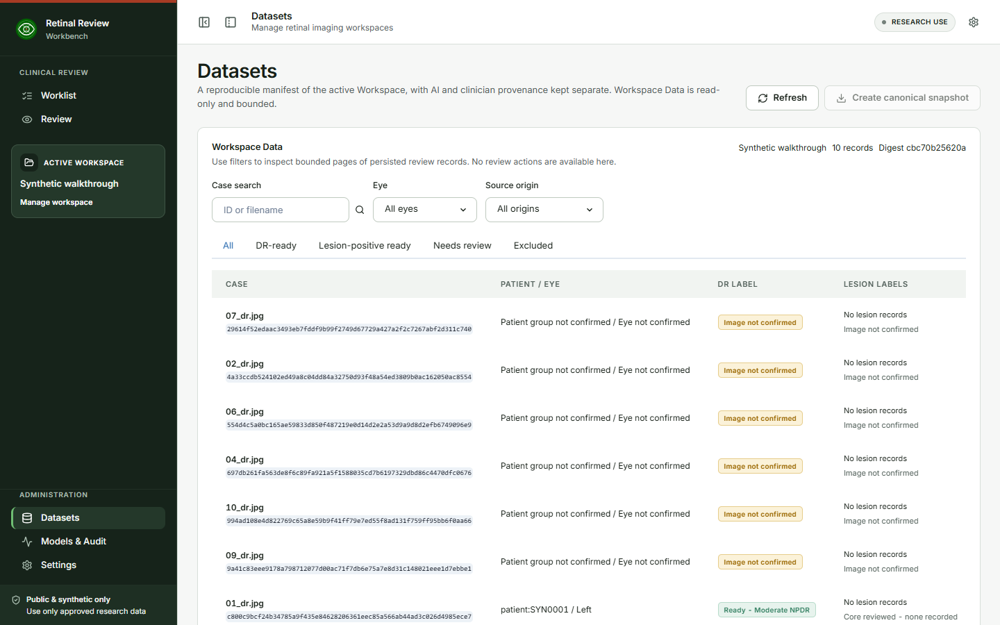
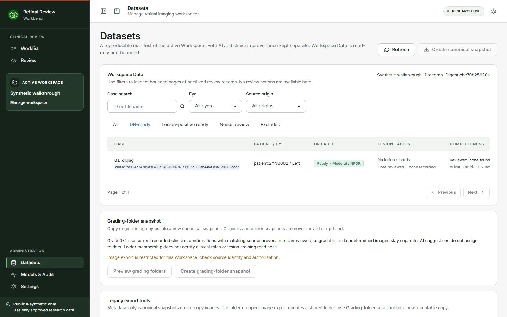
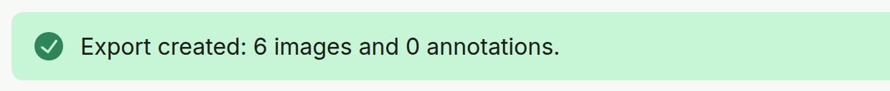

# Dataset Readiness and Export {#sec-datasets}

## Check readiness

**Purpose.** See which cases are ready for each task. Classification readiness and lesion readiness are separate states.

**Steps.**

1. Open **Datasets**. **Workspace Data** shows the active Workspace, the number of records, and a digest. It is read-only; no review actions are available here.
2. Narrow the list with **Case search**, **Eye**, or **Source origin**.
3. Choose a tab: **All**, **DR-ready**, **Lesion-positive ready**, **Needs review**, or **Excluded**.
4. Read the **DR label** and **Lesion labels** columns. **Details** opens one record with **Review**, **Processing**, **AI evidence**, and **Eligibility** tabs.
5. Fix a case in **Clinician Review** or **Annotation Editor** when its status asks for it.

{#fig-dataset-summary width=70%}

{#fig-dataset-readiness width=80%}

**Expected result.**

- **DR-ready** needs valid source provenance, an included fundus image, and a final clinician grade with reviewer and timestamp.
- **Lesion-ready** needs valid source provenance, an included fundus image, and a current Finish confirmation whose internal annotation-confirmation hash matches the active set.
- The **Lesion-positive ready** tab lists cases whose confirmed human lesion labels are ready. A reviewed-none case shows *Core reviewed - none recorded* under **Lesion labels** instead.

A reviewed-empty Core set is completeness evidence only. It does not create a negative lesion annotation or authorize a Phase 4 reviewed-negative export.

One task can be ready while the other is not. AI-only evidence is never promoted to ground truth by itself.

## Export

For image organization, use **Grading-folder snapshot**: choose **Preview grading folders**, inspect the counts and
skipped sources, then **Create grading-folder snapshot**. Grade0-4 contains current
recorded clinician confirmations with source provenance; UNREVIEWED, UNGRADABLE
and UNDETERMINED are separate. The new snapshot copies original bytes and preserves
previous snapshots after a grade revision. Folder membership does not certify
lesion labels or clinician credentials. Already authorized hospital sources may
be copied locally under the approved workstation policy; this is not a network
transfer grant.
See [grade-organized snapshots](../../operations/GRADING_FOLDER_SNAPSHOTS.md) for
completion, authorization and recovery limits.

The manifest export sits under **Legacy export tools**, together with **Export grouped images** (an older export that updates a shared folder). **Create canonical snapshot** at the top of the page writes a metadata-only snapshot and copies no images.

**Steps.**

1. Check the readiness of the active Workspace.
2. Under **Legacy export tools**, choose **Export manifest**.
3. Read the confirmation message, for example *Export created: 12 images and 30 annotations.*

{#fig-export width=62%}

**Expected result.** The package is written to the Workspace output folder: `manifest.json`, `images.csv`, and `annotations.csv` (schema `s4.dataset-manifest.v3`). Source images and case records are not changed. AI predictions and physician-confirmed labels stay in separate fields (for example `ai_grade` and `clinician_grade`). Untouched AI, human-authored, corrected, removed, and CVAT-imported states remain distinguishable in the export.

::: {.callout-important title="Important: local destinations only"}
Hospital records are exported only to the Workspace output folder on this computer. Any export, snapshot, or grouped-image copy that includes hospital records is refused when that folder is on a network share or synced to a cloud service such as OneDrive, Dropbox, or Google Drive. Ask your operator to choose a local Workspace output folder in **Settings**.
:::
