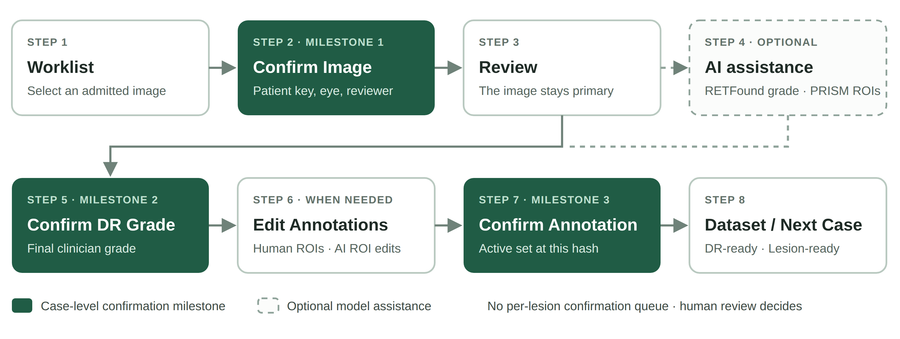

<!-- canonical-topic: clinician-workflow -->

# Quick Start {#sec-quick-start}

Retinal Review Workbench takes one admitted retinal image through a controlled review and turns the clinician's decisions into a traceable dataset record. Use this page as the everyday checklist; the following chapters explain each step.

{#fig-workflow width=100%}

The whole review is one forward line for one image at a time:

1. **Worklist**: choose **Confirm Image** in the case row.
2. **Confirm Image**: check the image type, patient, and eye beside the retinal image, optionally record **Image quality (optional)**, then choose **Confirm image & continue**. Review opens.
3. **Review**: inspect the retinal image and the optional RETFound grade and PRISM-DR lesion suggestions. Choose **Continue to clinician review**; nothing is decided on this page.
4. **Clinician Review**: click a grade button (0-4) or **Ungradable**, then choose **Confirm DR grade** (or **Confirm Ungradable**). After a DR grade, the Annotation Editor opens.
5. **Annotation Editor**: optional. Use the image-first **Box** workflow; click an AI ROI only where you disagree, change its class or box, and choose **Confirm** or **Remove**.
6. **Finish**: the button reads **Finish image & next** when you recorded findings, or **Finish: reviewed none found** / **Finish: no findings added (N AI suggestions not accepted)** when you did not. *Case complete: opening next image* appears and the next unfinished Worklist image opens.

There is no separate "not confirmed" or senior-review button: a grade is simply *Not confirmed* until you choose **Confirm DR grade**. Datasets (@sec-datasets) shows DR-ready and Lesion-ready separately whenever you need them.

::: {.callout-important title="Important: three confirmations"}
**Confirm Image**, **Confirm DR grade**, and the Finish button are the only case-level confirmations. AI suggestions never need to be accepted or rejected one by one before the review can be completed; the internal third milestone remains annotation confirmation.
:::
