## ก่อนเริ่มใช้งาน

### ระบบนี้คืออะไร

Retinal Review Workbench คือเว็บแอปสำหรับคัดกรองเบาหวานขึ้นจอประสาทตา (DR) ใช้ผ่าน browser เช่น Microsoft Edge หรือ Google Chrome ผู้ใช้ทำงานหลัก 5 อย่าง

- ยืนยันภาพ (ชนิดภาพ ผู้ป่วย ตาข้างที่ถ่าย คุณภาพภาพ)
- เลือกเกรด DR สุดท้าย
- วาดกรอบรอยโรค (annotation) และตัดสินกรอบที่ AI เสนอ
- เตรียมและลงนามรายงานคัดกรอง แล้วส่งต่อผู้ป่วยที่ต้อง Refer
- ส่งออกชุดข้อมูลเพื่องานวิจัย

AI ในระบบมีสองแบบ RETFound และ USPEC เสนอเกรด DR ส่วน PRISM เสนอตำแหน่งรอยโรค ทั้งหมดเป็นแค่ตัวช่วย ถ้าไม่มี AI ระบบก็ยังใช้ตรวจภาพเองได้ครบทุกขั้น

!!! danger "อ่านก่อนใช้งาน"
    - ระบบนี้**ไม่ใช่เครื่องมือวินิจฉัย** และยังไม่ผ่านการรับรองทางคลินิก
    - เกรดและ annotation ที่คนยืนยันคือผลจริงเสมอ ผล AI ที่มาทีหลังไม่ลบเกรดที่ยืนยันแล้ว
    - ผล AI ที่ว่าง (ไม่มีกรอบรอยโรค) **ไม่ได้แปลว่าไม่มีรอยโรค** แปลแค่ว่า AI ไม่ได้เสนออะไร
    - คะแนนของโมเดล (เช่น 70%) เป็นคะแนนดิบ **ไม่ใช่ความน่าจะเป็นทางคลินิก**
    - ส่งไปที่ server ของทีม (dr-train) ได้เฉพาะภาพสาธารณะหรือภาพที่ได้รับ consent เท่านั้น การใช้งานจริงกับภาพผู้ป่วยต้องใช้ server ของโรงพยาบาล

### สิ่งที่ต้องมี

1. คอมพิวเตอร์ที่มี browser รุ่นใหม่ (Edge หรือ Chrome)
2. ที่อยู่เว็บของระบบจากผู้ดูแล เช่น `https://localhost/app/` (เครื่องเดียว) หรือ `https://<ชื่อเครื่อง server>/app/` (ในโรงพยาบาล)
3. ชื่อผู้ใช้และรหัสผ่านชั่วคราวจากผู้ดูแลระบบ

### เกี่ยวกับภาพในคู่มือนี้

ภาพหน้าจอทั้งหมดถ่ายจากแอปจริงที่รันบนเครื่องทดสอบเมื่อ 1 พฤศจิกายน 2569 เปิดภาษาไทย และใช้**ข้อมูลตัวอย่างเท่านั้น**

- ภาพจอประสาทตา 10 ภาพ (`01_dr.jpg` ถึง `10_dr.jpg`) เป็นภาพสาธารณะจากชุด HRF
- ภาพ `SYNTH_001.png` เป็นภาพสังเคราะห์ ไม่ใช่ภาพจอประสาทตาจริง ผล AI บนภาพนี้มาจากโมเดลจำลอง (`mock-global`, `mock-lesion`) เพื่อสาธิตหน้าจอเท่านั้น **ไม่ใช่ผลของโมเดลจริง**
- ชื่อผู้ป่วยและ HN ในภาพ เช่น `Demo patient (synthetic)` และ `DEMO-0002` เป็นข้อมูลสมมติ
- บัญชีในภาพ (`admin.demo`, `dr.demo`, `nurse.demo`, `expert.demo`) เป็นบัญชีทดสอบที่ลบทิ้งแล้ว

ตัวเลขในวงกลมสีส้มบนภาพตรงกับขั้นตอนที่มีเลขเดียวกันในเนื้อหา

### บทบาทของผู้ใช้

| บทบาท | ชื่อในระบบ | งานหลัก |
| --- | --- | --- |
| พยาบาล | Nurse | ยืนยันภาพ เตรียมรายงานคัดกรอง |
| แพทย์ | Physician | ยืนยันเกรด DR วาด annotation ลงนามรายงาน ส่งต่อ |
| จักษุแพทย์ | Ophthalmologist (expert) | งานเดียวกับแพทย์ และให้เกรด Gold-100 |
| นักวิจัย | Researcher | ดูข้อมูลและส่งออกชุดข้อมูลแบบไม่ระบุตัวตน |
| ผู้ดูแลระบบ | Administrator | จัดการบัญชี Workspace AI server และตัวเชื่อมการส่งต่อ |

รายละเอียดว่าแต่ละบทบาททำอะไรได้หรือไม่ได้อยู่ในบท "สิทธิ์ของแต่ละบทบาท"

## ลงชื่อเข้าใช้และสลับภาษา

### ลงชื่อเข้าใช้

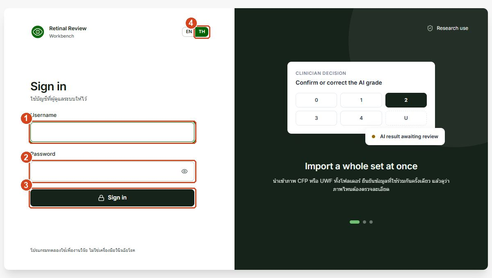

1. พิมพ์ชื่อผู้ใช้ (Username)
2. พิมพ์รหัสผ่าน (Password) กดรูปตาเพื่อดูสิ่งที่พิมพ์ได้
3. กด **Sign in**
4. ปุ่ม **EN / TH** ใช้สลับภาษาได้ตั้งแต่หน้านี้

### เปลี่ยนรหัสผ่านครั้งแรก

ครั้งแรกที่เข้าด้วยรหัสผ่านชั่วคราว ระบบจะให้ตั้งรหัสผ่านของตัวเองก่อนใช้งาน

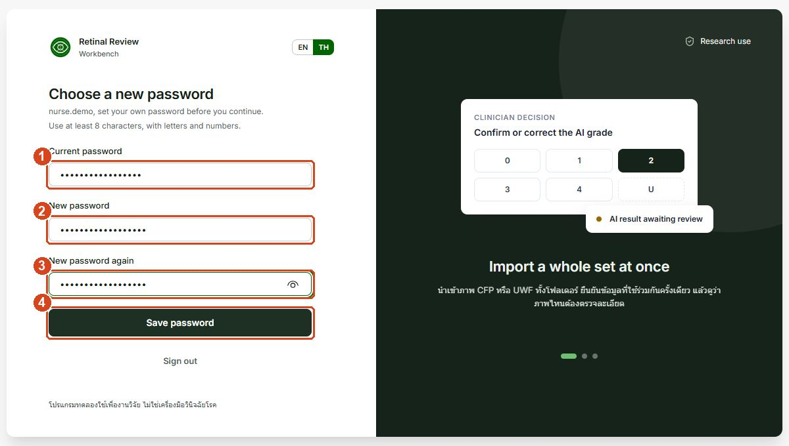

1. ช่อง **Current password** ใส่รหัสผ่านชั่วคราวที่ได้รับ
2. ช่อง **New password** ใส่รหัสผ่านใหม่
3. ช่อง **New password again** ใส่รหัสผ่านใหม่ซ้ำ
4. กด **Save password**

ค่าเริ่มต้นของรหัสผ่านคือยาวอย่างน้อย 8 ตัวอักษร และต้องมีทั้งตัวอักษรและตัวเลข ผู้ดูแลระบบปรับเกณฑ์นี้ได้ เมื่อตั้งรหัสใหม่แล้ว การเข้าใช้ที่ค้างอยู่ในเครื่องอื่นของบัญชีเดียวกันจะถูกตัดออก

!!! note "ความปลอดภัยของบัญชี"
    - ใส่รหัสผิดเกิน 5 ครั้ง บัญชีจะถูกล็อก 5 นาที (ค่าเริ่มต้น)
    - ไม่ได้ใช้งานนาน 30 นาที ระบบจะออกจากระบบให้เอง (ค่าเริ่มต้น)
    - ห้ามบอกรหัสผ่านให้คนอื่น ถ้าลืมรหัส ให้ผู้ดูแลระบบตั้งรหัสชั่วคราวให้ใหม่

### สลับภาษาและออกจากระบบ

- ปุ่ม **EN / TH** อยู่มุมขวาบนของทุกหน้า กด **TH** เพื่อใช้ภาษาไทย ระบบจำค่านี้ไว้ในเครื่องที่ใช้อยู่
- ในโหมดภาษาไทย หัวข้อ ชื่อปุ่มหลัก ชื่อสถานะใน Worklist และศัพท์เทคนิคยังเป็นภาษาอังกฤษตามที่ออกแบบไว้ คำอธิบายเป็นภาษาไทย
- กด **ออกจากระบบ** มุมขวาบนเมื่อเลิกใช้งาน โดยเฉพาะเครื่องที่ใช้ร่วมกัน

## หน้า Today

หลังเข้าใช้ ระบบเปิดหน้า **Today** เป็นหน้าแรก

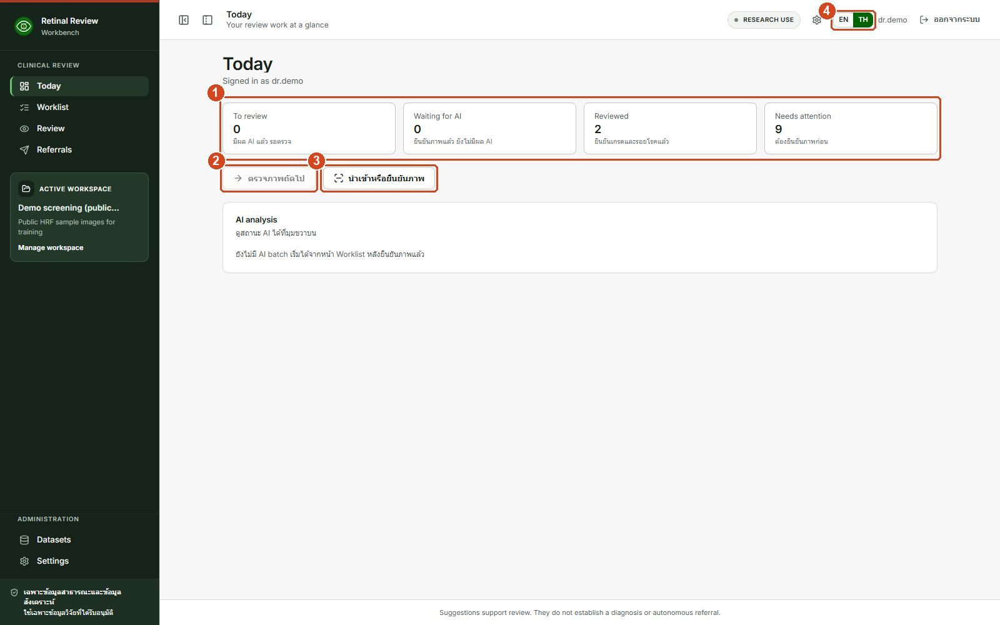

1. การ์ดสรุปงาน 4 ใบ
    - **To review** ภาพที่มีผล AI แล้ว รอคนตรวจ
    - **Waiting for AI** ภาพที่ยืนยันแล้วแต่ยังไม่มีผล AI
    - **Reviewed** ภาพที่ยืนยันเกรดและรอยโรคแล้ว
    - **Needs attention** ภาพที่ยังต้องยืนยันภาพก่อน
2. ปุ่ม **ตรวจภาพถัดไป** พาไปภาพที่ควรตรวจต่อ
3. ปุ่ม **นำเข้าหรือยืนยันภาพ** พาไปหน้า Worklist
4. ปุ่มสลับภาษา **EN / TH**

แถบด้านซ้ายมีเมนูทุกหน้า เมนูที่เห็นขึ้นกับบทบาท เช่น แพทย์ไม่เห็นเมนู Gold-100 และ Admin

## Workspace และการนำเข้าภาพ

### Workspace คืออะไร

Workspace คือชุดงานหนึ่งชุด ผูกกับโฟลเดอร์ภาพนำเข้า (Input folder) และโฟลเดอร์ผลลัพธ์ (Output folder) **ผู้ดูแลระบบเป็นคนสร้างและแก้ Workspace** แพทย์และจักษุแพทย์สลับไปใช้ Workspace ที่มีอยู่แล้วได้

!!! warning "ระบบไม่แก้ไขภาพต้นฉบับ"
    ระบบอ่านภาพจากโฟลเดอร์เท่านั้น ไม่ย้าย ไม่เปลี่ยนชื่อ ไม่แก้ไข และไม่ลบภาพต้นฉบับ การลบ Workspace ลบแค่โปรไฟล์ ไม่ลบภาพ โฟลเดอร์ หรือข้อมูลการตรวจ

### สร้าง Workspace (ผู้ดูแลระบบ)

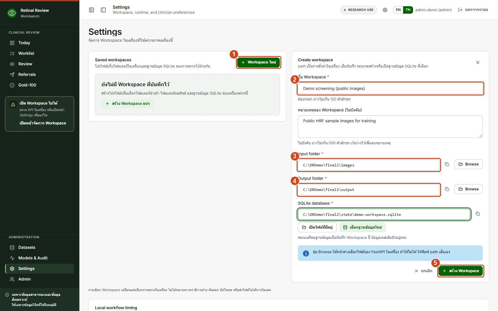

1. ไปที่ **Settings** แล้วกด **Workspace ใหม่**
2. ตั้งชื่อ Workspace และใส่หมายเหตุถ้าต้องการ
3. **Input folder** โฟลเดอร์ที่เก็บภาพจอประสาทตา พิมพ์ path เต็ม หรือกด **Browse**
4. **Output folder** โฟลเดอร์สำหรับไฟล์ที่ส่งออก
5. กด **สร้าง Workspace**

ในเครื่องที่ใช้ PostgreSQL (การติดตั้งปกติ) ไม่มีช่อง SQLite database ในภาพนี้มีช่องนั้นเพราะเครื่องทดสอบใช้ SQLite

### Worklist และการสแกนโฟลเดอร์

หน้า **Worklist** แสดงทุกภาพใน Workspace ที่เปิดอยู่

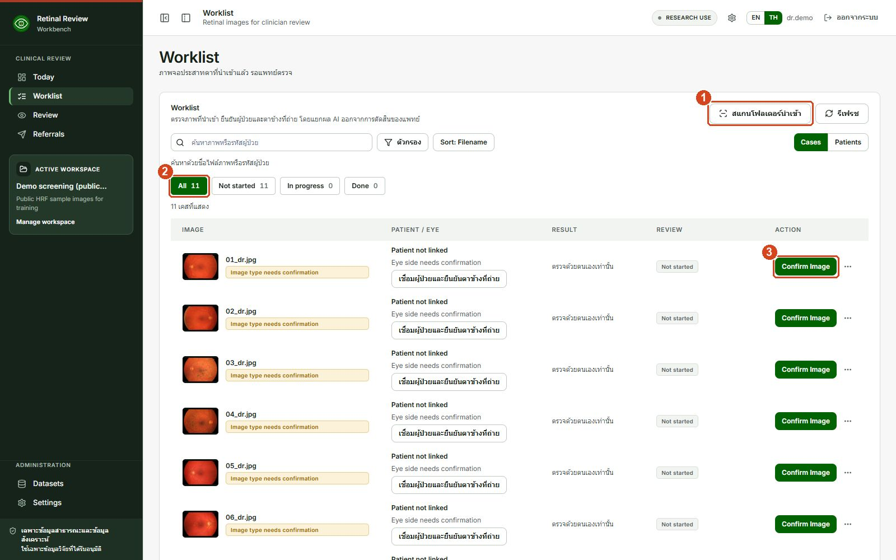

1. **สแกนโฟลเดอร์นำเข้า** อ่านโฟลเดอร์ Input อีกครั้งเมื่อมีภาพใหม่
2. ตัวกรองสถานะ **All / Not started / In progress / Done** และช่องค้นหาด้วยชื่อไฟล์หรือรหัสผู้ป่วย มุมมอง **Cases** (รายภาพ) หรือ **Patients** (รายผู้ป่วย)
3. ปุ่ม **Confirm Image** ของแต่ละภาพ เริ่มขั้นตอนยืนยันภาพ

สิ่งที่ควรรู้เรื่องการนำเข้า

- ระบบอ่านเฉพาะไฟล์ชั้นบนสุดของโฟลเดอร์ ไฟล์ในโฟลเดอร์ย่อยจะไม่ถูกนำเข้า
- ไฟล์ที่รับ: `.jpg`, `.jpeg`, `.png`, `.tif`, `.tiff`, `.dcm`, `.dicom`
- ภาพที่เนื้อไฟล์เหมือนกันทุกไบต์นับเป็นภาพเดียว
- ไฟล์ที่หายไปจากโฟลเดอร์จะขึ้นสถานะว่าหาไฟล์ไม่พบ ระบบไม่ลบข้อมูลการตรวจของภาพนั้น
- ชนิดภาพเริ่มต้นเป็น "ยังไม่แน่ใจ" (ป้ายสีเหลือง **Image type needs confirmation**) คนต้องยืนยันว่าเป็น CFP หรือ UWF ก่อน AI จึงจะวิเคราะห์ได้

## ยืนยันภาพ (Confirm Image)

กด **Confirm Image** ที่ภาพใน Worklist จะเปิดหน้าต่างยืนยันภาพ

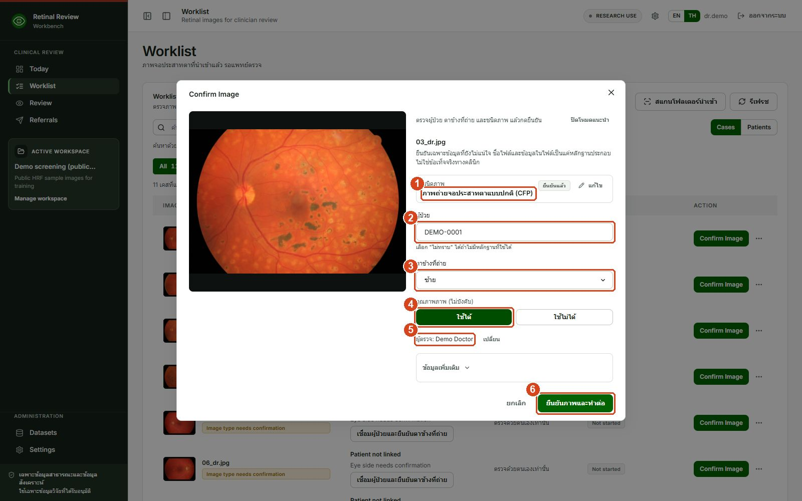

1. **ชนิดภาพ** เลือก **ภาพถ่ายจอประสาทตาแบบปกติ (CFP)** หรือ **Ultra-widefield (UWF)** ถ้าไม่แน่ใจให้เลือก "ยังไม่แน่ใจ" ไว้ก่อน
2. **ผู้ป่วย** ใส่รหัสแฝงของผู้ป่วย หรือเว้นว่าง
3. **ตาข้างที่ถ่าย** เลือก ซ้าย ขวา หรือ ไม่ทราบ
4. **คุณภาพภาพ** (ไม่บังคับ) เลือก **ใช้ได้** หรือ **ใช้ไม่ได้**
5. **ผู้ตรวจ** ชื่อผู้ตรวจ ถ้าตั้งชื่อเริ่มต้นไว้ในหน้า Settings ระบบจะใส่ให้ กด **เปลี่ยน** เพื่อแก้
6. กด **ยืนยันภาพและทำต่อ**

ยืนยันเฉพาะข้อมูลที่แน่ใจ ชื่อไฟล์เป็นแค่หลักฐานประกอบ ไม่ใช่ข้อเท็จจริงทางคลินิก ระบบไม่เดาข้อมูลที่ขัดกันแทนคน เมื่อยืนยันแล้วระบบเปิดหน้า **Review** ของภาพนั้น

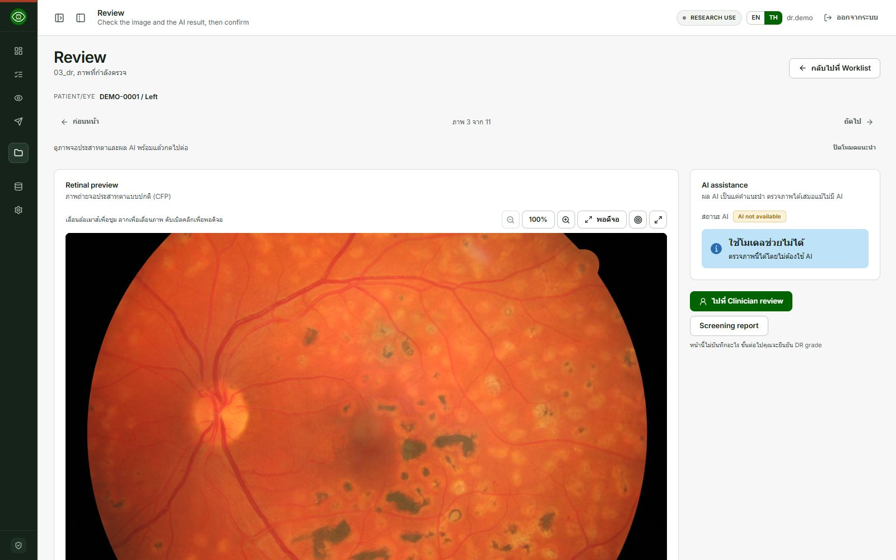

ในหน้า Review ใช้ปุ่มซูม **พอดีจอ** และ **เปิดตรวจแบบเต็มจอ** เพื่อดูภาพละเอียด ปุ่ม **ก่อนหน้า / ถัดไป** ใช้เลื่อนไปภาพอื่น

## ผล AI: เกรดที่ AI เสนอ

ถ้าเชื่อมต่อ AI server ไว้ ภาพที่ยืนยันชนิดแล้วจะวิเคราะห์ได้ (ทีละภาพในหน้า Review หรือเป็นชุดจากแผง AI batch ในหน้า Worklist) ผลจะขึ้นในหน้า Review

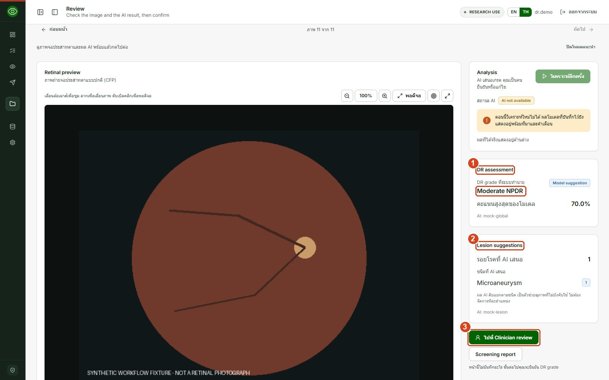

1. การ์ด **DR assessment** แสดง **DR grade ที่ระบบทำนาย** ป้าย **Model suggestion** และคะแนนสูงสุดของโมเดล
2. การ์ด **Lesion suggestions** แสดงจำนวนและชนิดรอยโรคที่ AI เสนอ
3. กด **ไปที่ Clinician review** เพื่อเลือกเกรดสุดท้าย

!!! warning "ผล AI เป็นแค่ข้อเสนอ"
    - เกรดที่ AI เสนอ**ไม่ใช่**เกรดสุดท้าย คนต้องยืนยันหรือแก้เสมอ
    - คะแนนในภาพ (70.0%) เป็นคะแนนดิบของโมเดล ไม่ใช่ความน่าจะเป็นที่ผ่านการปรับเทียบ (calibrated)
    - ภาพนี้เป็นภาพสังเคราะห์และผลมาจากโมเดลจำลอง ป้าย **AI not available** ในภาพหมายถึงเครื่องทดสอบไม่มี AI จริง ผลที่เห็นคือผลที่บันทึกไว้

ถ้าไม่มี AI server หรือ AI ใช้ไม่ได้ ระบบจะบอกว่า AI ไม่พร้อม ผู้ใช้ยังตรวจและให้เกรดเองได้ตามปกติ

## ยืนยันหรือแก้เกรด DR

หน้า **Clinician Review** ใช้เลือกเกรด DR สุดท้ายของภาพ

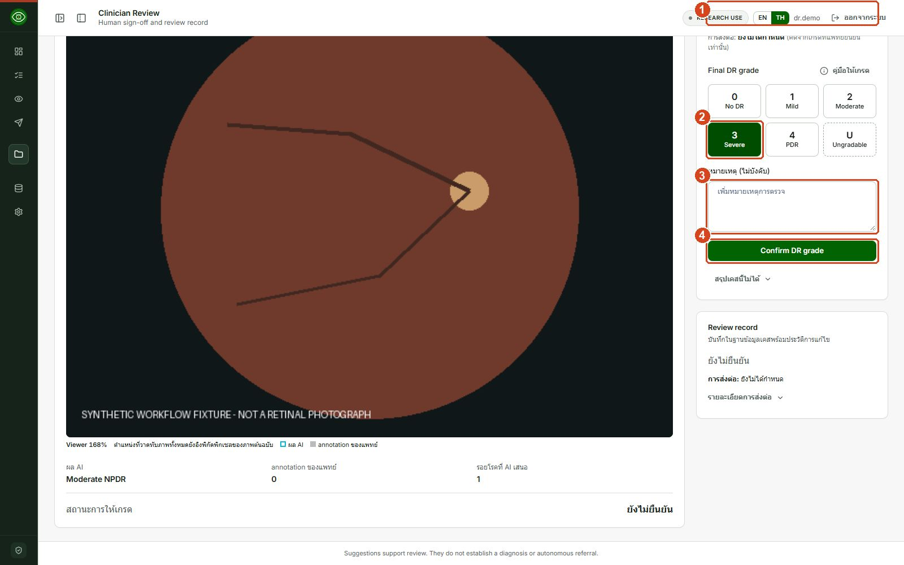

1. บรรทัด **ผล AI** แสดงเกรดที่ AI เสนอ ระบบไม่ได้เลือกไว้ให้
2. เลือก **Final DR grade**: 0 No DR, 1 Mild, 2 Moderate, 3 Severe, 4 PDR หรือ U Ungradable กด **คู่มือให้เกรด** เพื่อดูเกณฑ์
3. ใส่ **หมายเหตุ** ถ้าต้องการ
4. กด **Confirm DR grade**

- เลือกเกรดตรงกับ AI = ยอมรับ (Accept) เลือกเกรดอื่น = แก้เกรด (Correct grade) ระบบเก็บผล AI เดิมไว้ ไม่แก้ทับ
- ภาพที่สรุปไม่ได้ ใช้เมนู **สรุปเคสนี้ไม่ได้**
- บรรทัด **การส่งต่อ** คิดจากเกรดที่แพทย์ยืนยันเท่านั้น (กฎเดียวที่ได้รับอนุมัติคือเกรด 4) ระบบไม่ตัดสินการส่งต่อจากผล AI
- พยาบาลกด Confirm DR grade ไม่ได้ ระบบจะแจ้งว่าเกรดของพยาบาลเป็นเกรดเบื้องต้น ให้แพทย์ยืนยัน

เมื่อยืนยันเกรดแล้ว ระบบเปิด **Annotation Editor** ต่อให้ทันที

## Annotation และการตัดสินกรอบที่ AI เสนอ

### ตัดสินกรอบที่ AI เสนอ (AI-ROI)

กรอบสีฟ้าพร้อมป้าย เช่น `MA 0.80` คือรอยโรคที่ AI เสนอ คลิกที่กรอบเพื่อเปิดหน้าต่าง **ผล AI**

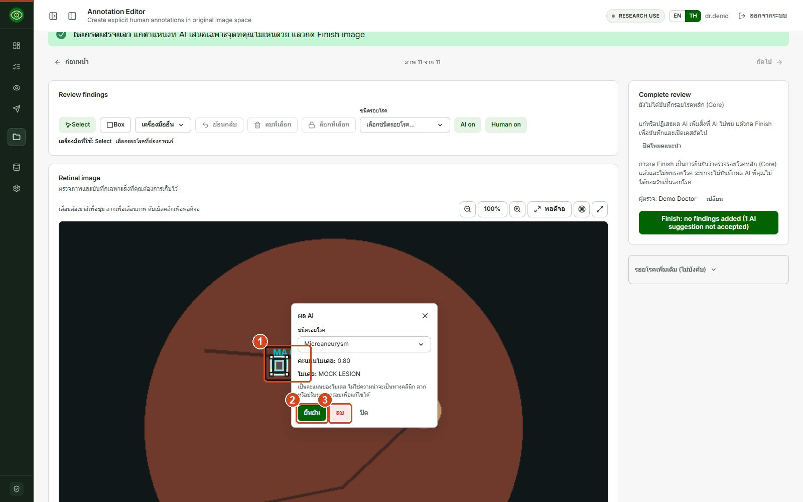

1. กรอบที่ AI เสนอ ลากเพื่อย้าย หรือลากมุมเพื่อปรับขนาดได้ เปลี่ยน **ชนิดรอยโรค** ได้ถ้า AI จัดชนิดผิด
2. กด **ยืนยัน** ถ้าเห็นด้วย ระบบบันทึกเป็น annotation ของคน
3. กด **ลบ** ถ้าไม่ใช่รอยโรค

ผล AI ดิบไม่ถูกแก้ไข การตัดสินของคนเก็บแยกไว้ ถ้าแก้ตำแหน่งหรือชนิด ระบบบันทึกเป็น annotation ของคนโดยไม่มีคะแนนโมเดล

### วาดกรอบรอยโรคเอง

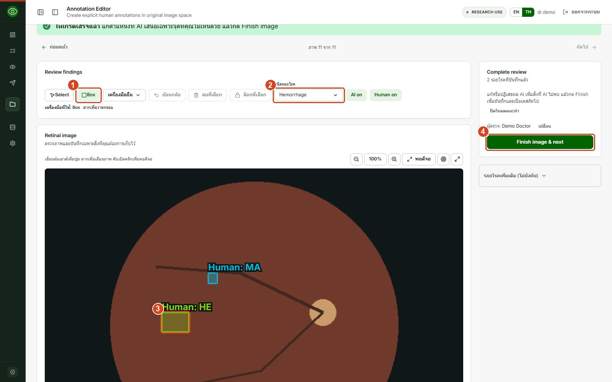

1. กดเครื่องมือ **Box**
2. เลือก **ชนิดรอยโรค**: Microaneurysm, Hemorrhage, Hard exudate หรือ Soft exudate
3. ลากบนภาพเพื่อวาดกรอบ กรอบของคนมีป้าย `Human:` นำหน้า
4. ทำครบแล้วกด **Finish image & next**

เครื่องมืออื่นในแถบเดียวกัน: **Select** เลือกกรอบ, **ย้อนกลับ**, **ลบที่เลือก**, **ล็อกที่เลือก**, ปุ่ม **AI on / Human on** ซ่อนหรือแสดงกรอบแต่ละแบบ ระบบบันทึก annotation ให้อัตโนมัติระหว่างทำงาน พิกัดทุกกรอบอ้างอิงพิกเซลของภาพต้นฉบับ

!!! note "Finish เมื่อไม่มีรอยโรค"
    ถ้าไม่พบรอยโรค ปุ่มจะขึ้นว่า **Finish: no findings added** การกด Finish แปลว่า "ตรวจแล้ว" ไม่ได้แปลว่ารับรองว่าภาพไม่มีรอยโรค กรอบที่ AI เสนอแต่ไม่ได้ยืนยันจะไม่ถูกบันทึกเป็นรอยโรค

## Finish image

กด **Finish image & next** ระบบบันทึกชุด annotation เป็นสถานะเสร็จ แจ้ง **เคสนี้เสร็จแล้ว กำลังเปิดภาพถัดไป** และเปิดภาพถัดไปที่ยังไม่ได้ยืนยัน

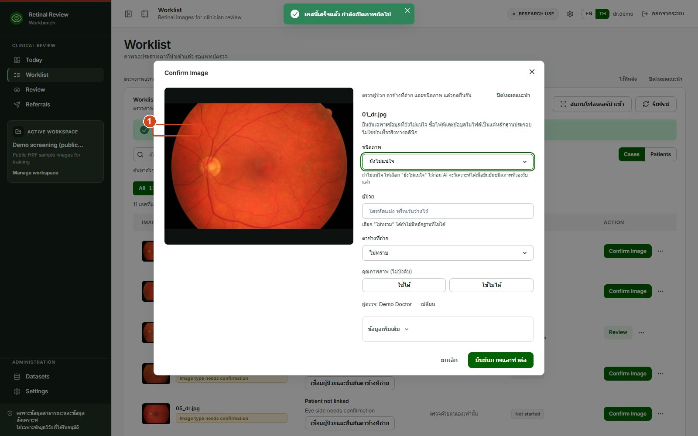

1. ข้อความยืนยันว่าภาพก่อนหน้าเสร็จแล้ว

ถ้าต้องการพัก กด **ยกเลิก** ในหน้าต่าง Confirm Image ถ้าภายหลังมีการแก้ annotation ของภาพที่ Finish แล้ว สถานะจะกลับเป็น "ต้องยืนยันใหม่" ต้องกด Finish อีกครั้ง

## รายงานคัดกรอง (Screening Report)

รายงานคัดกรองเป็นแบบฟอร์ม A4 **พยาบาลเตรียมรายงาน แพทย์เป็นผู้ลงนาม** ผู้ให้เกรดเป็นคนเลือก Refer หรือ Not refer เอง ระบบไม่ตัดสินแทน เปิดรายงานได้จากปุ่ม **Screening report** ในหน้า Review

### พยาบาลกรอกข้อมูลผู้ป่วย

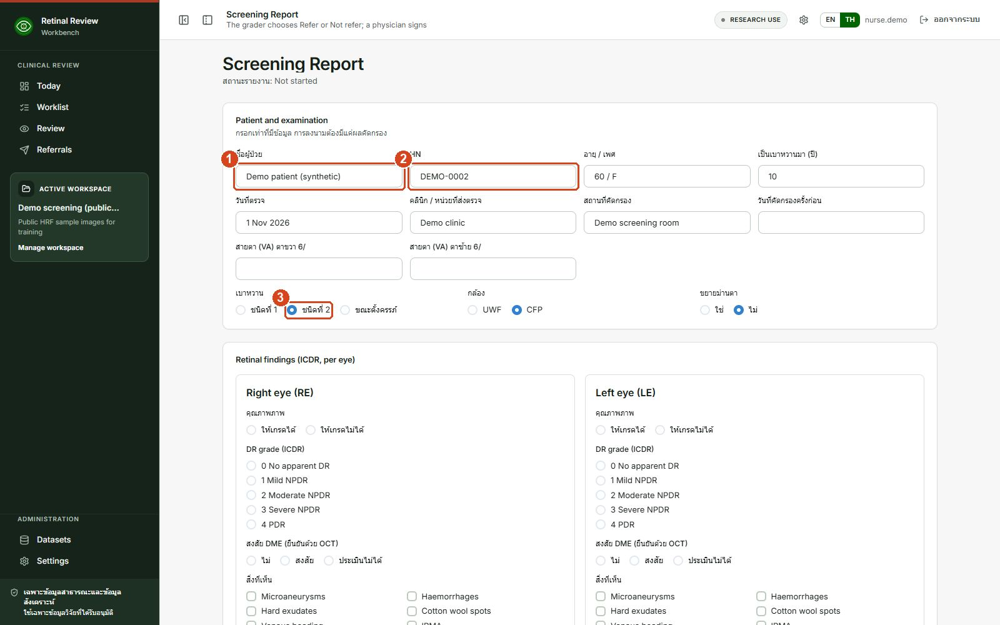

1. **ชื่อผู้ป่วย**
2. **HN**
3. ข้อมูลอื่นที่มี เช่น อายุ เพศ ชนิดเบาหวาน กล้อง (UWF หรือ CFP) การขยายม่านตา ช่องที่ไม่มีข้อมูลเว้นว่างได้

### กรอกผลตรวจรายตา

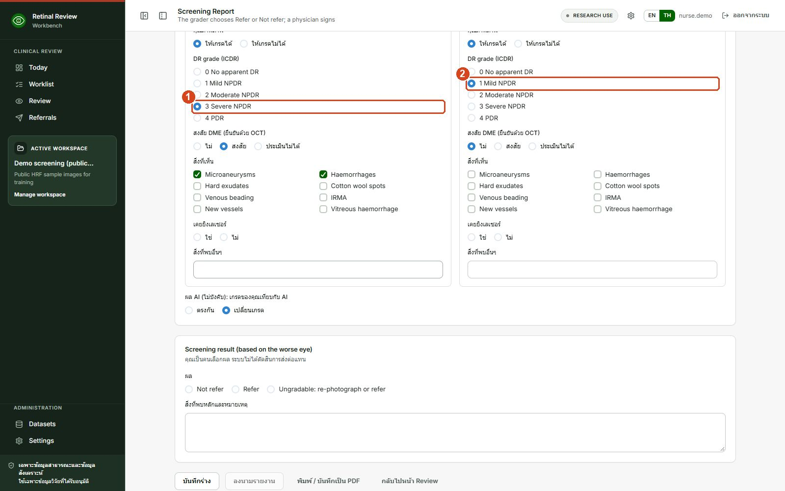

1. ตาขวา: คุณภาพภาพ เกรด DR (ICDR) สงสัย DME สิ่งที่เห็น เคยยิงเลเซอร์
2. ตาซ้าย: กรอกแบบเดียวกัน

ใต้ผลรายตามีช่อง **ผล AI (ไม่บังคับ)** บอกว่าเกรดของผู้ตรวจตรงกับ AI หรือเปลี่ยนเกรด

### เลือกผลคัดกรองและบันทึกร่าง

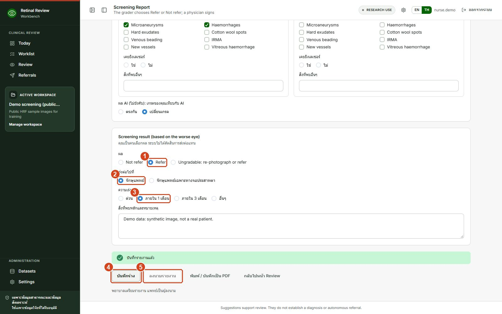

1. **ผล** เลือก **Not refer**, **Refer** หรือ **Ungradable: re-photograph or refer** โดยดูจากตาข้างที่แย่กว่า
2. ถ้า Refer เลือก **ส่งต่อไปที่** จักษุแพทย์ หรือจักษุแพทย์เฉพาะทางจอประสาทตา (ถ้า Not refer เลือกนัดคัดกรองซ้ำใน 1 ปี หรือ 6 ถึง 12 เดือน)
3. เลือก **ความเร่งด่วน**
4. กด **บันทึกร่าง** สถานะรายงานของพยาบาลเป็นฉบับเบื้องต้น
5. ปุ่ม **ลงนามรายงาน** ใช้ไม่ได้สำหรับพยาบาล ระบบแสดง "พยาบาลเตรียมรายงาน แพทย์เป็นผู้ลงนาม"

### แพทย์ลงนามและพิมพ์

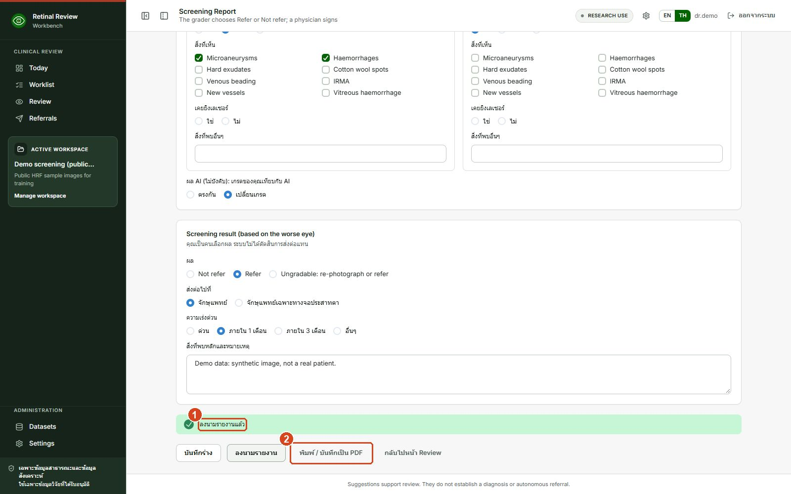

1. แพทย์เปิดรายงานเดียวกัน ตรวจข้อมูล แก้ได้ถ้าจำเป็น แล้วกด **ลงนามรายงาน** ระบบแจ้ง **ลงนามรายงานแล้ว**
2. กด **พิมพ์ / บันทึกเป็น PDF** ระบบเปิดหน้าพิมพ์ในแท็บใหม่ กดปุ่ม **Print / Save as PDF** ด้านบน แล้วเลือกเครื่องพิมพ์ หรือเลือก "Save as PDF" (บันทึกเป็น PDF) ใน browser

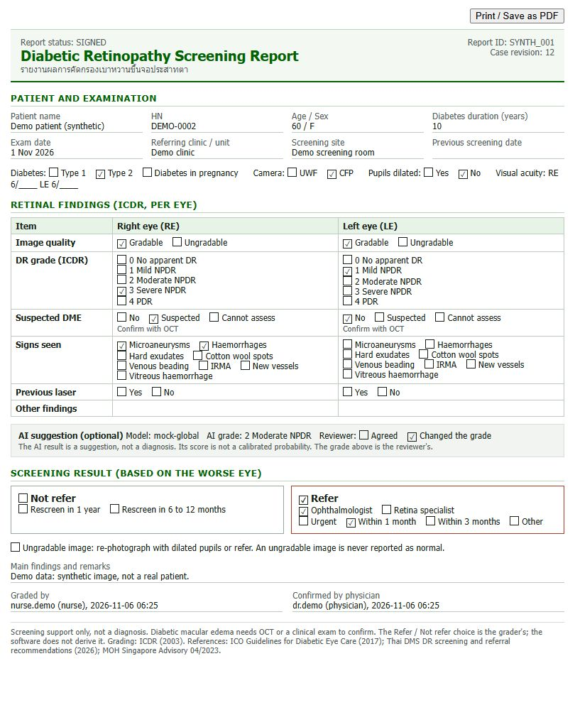

หน้าพิมพ์แสดงสถานะ SIGNED ชื่อผู้ให้เกรด ชื่อแพทย์ผู้ยืนยัน และหมายเหตุว่าเป็นการคัดกรอง ไม่ใช่การวินิจฉัย การเลือก Refer หรือ Not refer เป็นของผู้ให้เกรด ถ้าพยาบาลแก้รายงานหลังลงนามแล้ว ระบบไม่ยอม มีเพียงบทบาทที่ลงนามได้ที่แก้ได้ และระบบเก็บฉบับที่ลงนามไว้

## รายการส่งต่อ (Referrals)

หน้า **Referrals** แสดงเฉพาะรายงานที่ลงนามแล้วและผู้ให้เกรดเลือก Refer หรือ Ungradable ระบบไม่สร้างรายการส่งต่อเอง

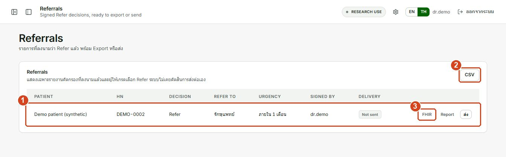

1. แต่ละแถวแสดงผู้ป่วย HN ผลการตัดสิน ส่งต่อไปที่ ความเร่งด่วน ผู้ลงนาม และสถานะการส่ง (เริ่มต้นเป็น **Not sent**)
2. **CSV** ดาวน์โหลดรายการทั้งหมดเป็นไฟล์ CSV
3. **FHIR** เปิดข้อมูลรายการนั้นในรูปแบบ FHIR R4 (JSON) ปุ่ม **Report** เปิดรายงาน

ปุ่ม **ส่ง** ส่งรายการผ่านตัวเชื่อมที่ผู้ดูแลระบบตั้งไว้ กดหนึ่งครั้งส่งหนึ่งครั้ง ระบบบันทึกทุกครั้งที่ส่ง และไม่ส่งซ้ำเอง ค่าเริ่มต้นของตัวเชื่อมคือ **ปิด** (ไม่มีข้อมูลออกจากระบบ) เฉพาะแพทย์ จักษุแพทย์ และผู้ดูแลระบบที่กดส่งได้ บัญชีนักวิจัยเปิดหน้านี้ไม่ได้เพราะมีชื่อผู้ป่วยและ HN

## ส่งออกชุดข้อมูล (Datasets)

หน้า **Datasets** สรุปข้อมูลของ Workspace ที่เปิดอยู่ แยกที่มาของผล AI กับผลของคนไว้เสมอ

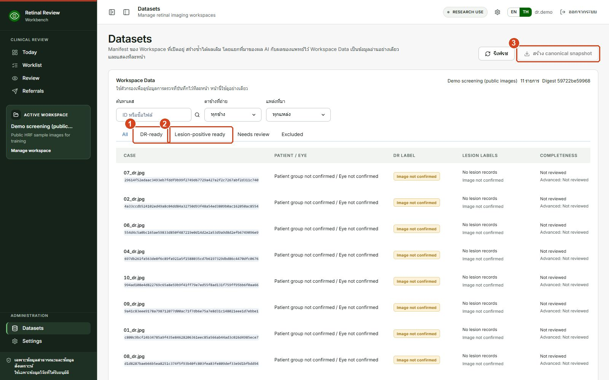

1. แท็บ **DR-ready** ภาพที่มีเกรด DR ที่คนยืนยันแล้ว พร้อมใช้ทำชุดข้อมูลเกรด
2. แท็บ **Lesion-positive ready** ภาพที่ annotation ครบพร้อมใช้ทำชุดข้อมูลรอยโรค แท็บ **Needs review** และ **Excluded** แสดงภาพที่ยังไม่พร้อมหรือถูกคัดออก
3. **สร้าง canonical snapshot** สร้างชุดส่งออกที่สร้างซ้ำได้ผลเดิม ไฟล์ไปอยู่ในโฟลเดอร์ Output ของ Workspace

ใช้ช่องค้นหา ตาข้างที่ถ่าย และแหล่งที่มา เพื่อกรองรายการ หน้านี้เป็นข้อมูลอ่านอย่างเดียว ระบบเก็บโฟลเดอร์ผลทำนายของ AI แยกจากโฟลเดอร์เกรดที่คนยืนยัน พยาบาลส่งออกไม่ได้ นักวิจัยส่งออกได้แต่แก้เคสไม่ได้

## Gold-100 (จักษุแพทย์)

Gold-100 คือการให้เกรดอ้างอิงเพื่องานวิจัยโดยจักษุแพทย์ (บัญชี expert) จักษุแพทย์ให้เกรดก่อนโดยไม่เห็นผล AI แล้วจึงเปิดดูผล AI และให้เกรดสุดท้าย ข้อมูลนี้เก็บแยกจากเกรดคัดกรอง ไม่กระทบการตรวจทางคลินิก

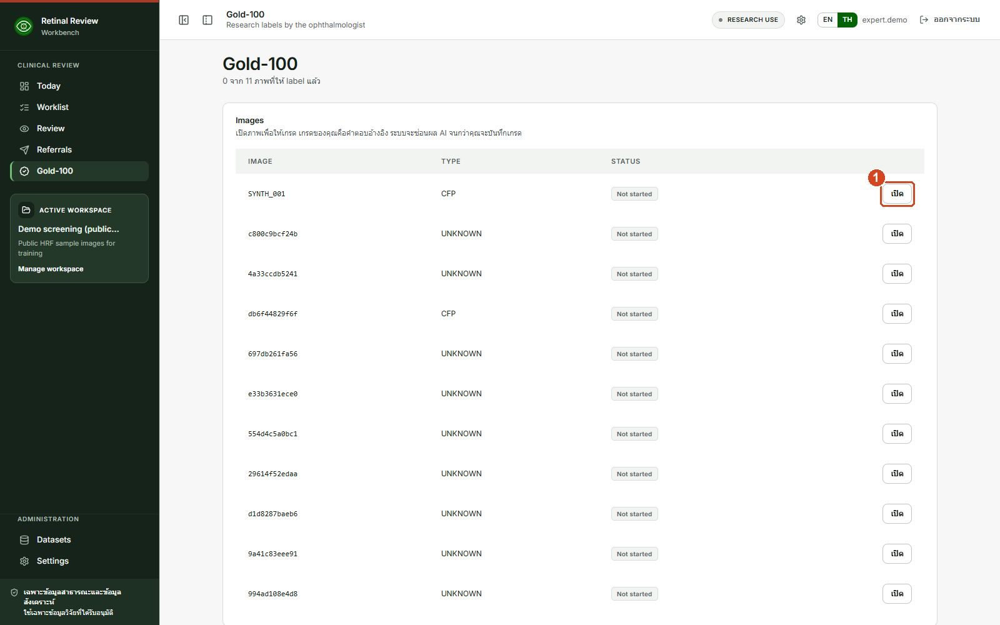

1. กด **เปิด** ที่ภาพที่ต้องการให้เกรด

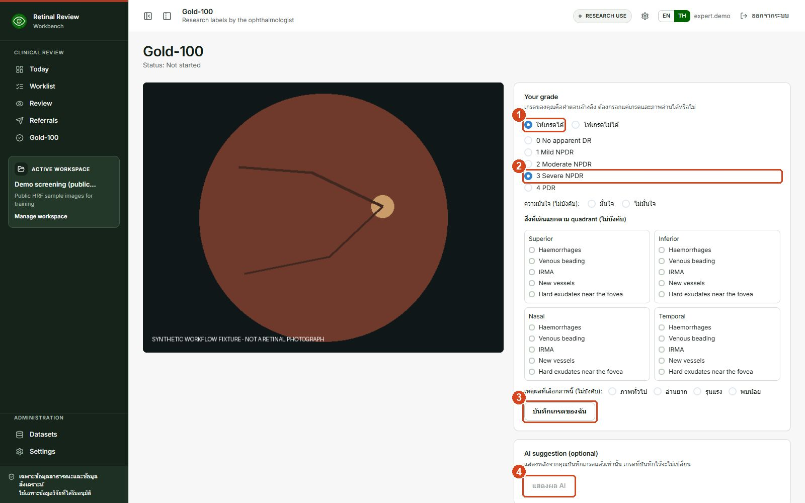

1. เลือก **ให้เกรดได้** หรือ **ให้เกรดไม่ได้**
2. เลือกเกรด 0 ถึง 4 (ความมั่นใจ สิ่งที่เห็นแยกตาม quadrant และเหตุผลที่เลือกภาพ ไม่บังคับ)
3. กด **บันทึกเกรดของฉัน** เกรดนี้จะถูกล็อก
4. จากนั้นกด **แสดงผล AI** เพื่อดูเกรดที่ AI เสนอ

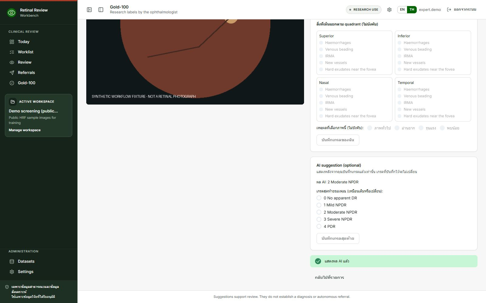

หลังเห็นผล AI ให้เลือก **เกรดสุดท้ายของคุณ** แล้วกด **บันทึกเกรดสุดท้าย** ระบบเก็บทั้งเกรดก่อนและหลังเห็น AI

## งานของผู้ดูแลระบบ (Admin)

หน้า **Admin** มี 4 แท็บ เปิดได้เฉพาะบัญชีผู้ดูแลระบบ

### บัญชีผู้ใช้และนโยบายรหัสผ่าน

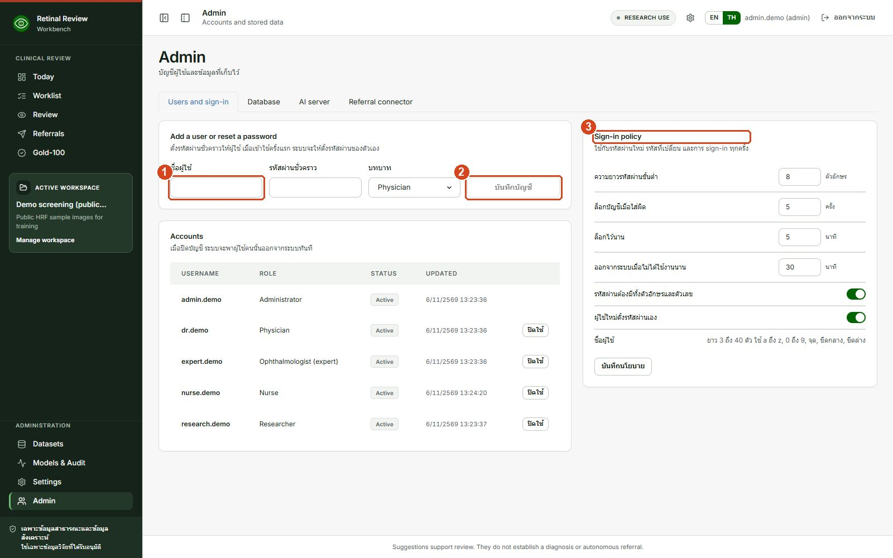

1. **เพิ่มผู้ใช้หรือรีเซ็ตรหัสผ่าน** ใส่ชื่อผู้ใช้ รหัสผ่านชั่วคราว และบทบาท ผู้ใช้จะต้องตั้งรหัสใหม่เมื่อเข้าครั้งแรก ใช้ฟอร์มเดียวกันนี้รีเซ็ตรหัสของคนที่ลืม
2. กด **บันทึกบัญชี** รายชื่อบัญชีอยู่ด้านล่าง กด **ปิดใช้** เพื่อระงับบัญชี (คนนั้นถูกออกจากระบบทันที)
3. **Sign-in policy** ความยาวรหัสผ่านขั้นต่ำ (6 ถึง 64) จำนวนครั้งที่ใส่ผิดก่อนล็อก (3 ถึง 10) เวลาล็อก (1 ถึง 60 นาที) เวลาออกจากระบบเมื่อไม่ใช้งาน (5 ถึง 480 นาที) และสวิตช์บังคับตัวอักษรกับตัวเลข และให้ผู้ใช้ใหม่ตั้งรหัสเอง กด **บันทึกนโยบาย**

ระบบไม่ยอมลดสิทธิ์หรือปิดบัญชีผู้ดูแลระบบคนสุดท้าย ชื่อผู้ใช้ใช้ได้ 3 ถึง 40 ตัว เป็น a ถึง z, 0 ถึง 9, จุด, ขีดกลาง หรือขีดล่าง

### เลือก AI server และ consent

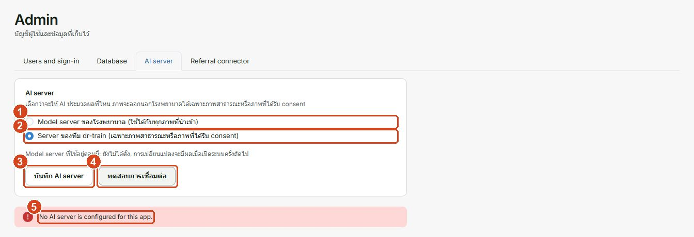

1. **Model server ของโรงพยาบาล** ใช้ได้กับทุกภาพที่นำเข้า (เป็นค่าที่ควรใช้กับภาพผู้ป่วยจริง)
2. **Server ของทีม dr-train** ใช้ได้เฉพาะภาพสาธารณะหรือภาพที่ได้รับ consent
3. กด **บันทึก AI server** การเปลี่ยนแปลงมีผลเมื่อเปิดระบบครั้งถัดไป
4. กด **ทดสอบการเชื่อมต่อ** ระบบลองติดต่อ AI server ที่ตั้งไว้ token อยู่ฝั่ง server ไม่ส่งมาที่ browser
5. ผลการทดสอบ ในภาพคือ "No AI server is configured for this app" เพราะเครื่องทดสอบไม่มี AI server

!!! warning "consent เป็นการตัดสินใจของเจ้าของโครงการ"
    เมื่อใช้ฐานข้อมูล PostgreSQL ตามปกติ หน้านี้จะมีช่องติ๊ก "Workspace นี้ (รหัส Workspace) มีเฉพาะภาพสาธารณะหรือภาพที่ได้รับ consent" (ภาพในคู่มือไม่มีช่องนี้เพราะเครื่องทดสอบใช้ SQLite) ติ๊กเฉพาะเมื่อแน่ใจว่าทุกภาพใน Workspace เป็นภาพสาธารณะหรือได้รับ consent แล้วจริง ปุ่ม demo ที่ใช้ dr-train จะถามข้อนี้ครั้งแรกที่เปิด และไม่ส่งภาพไปถ้ายังไม่ได้ยืนยัน

### ตัวเชื่อมการส่งต่อ (Referral connector)

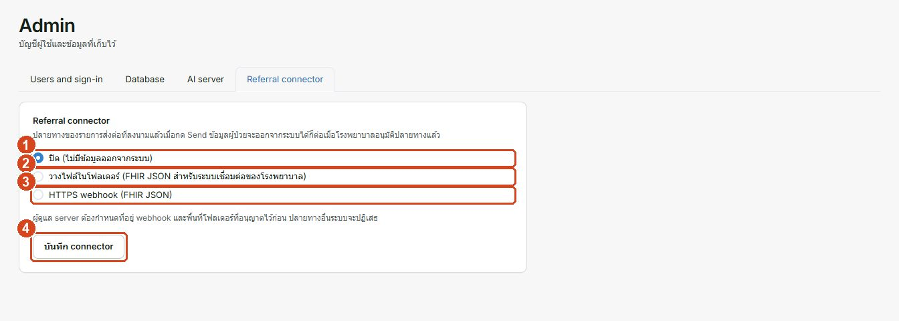

1. **ปิด** ไม่มีข้อมูลออกจากระบบ (ค่าเริ่มต้น)
2. **วางไฟล์ในโฟลเดอร์** เขียนไฟล์ FHIR JSON ลงโฟลเดอร์ให้ระบบเชื่อมต่อของโรงพยาบาลมารับ
3. **HTTPS webhook** ส่ง FHIR JSON ไปยังที่อยู่ https:// ที่กำหนด
4. กด **บันทึก connector**

ผู้ดูแล server ต้องกำหนดรายชื่อที่อยู่ webhook และพื้นที่โฟลเดอร์ที่อนุญาตไว้ก่อน (ค่า `DR_SUPPORT_REFERRAL_HOSTS` และ `DR_SUPPORT_REFERRAL_DROP_ROOT`) ปลายทางอื่นระบบจะปฏิเสธ ข้อมูลผู้ป่วยออกจากระบบได้ก็ต่อเมื่อโรงพยาบาลอนุมัติปลายทางแล้ว

### ดูฐานข้อมูล (Database)

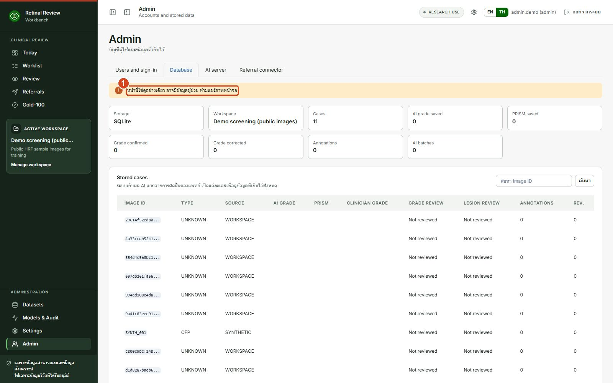

1. หน้านี้ใช้ดูอย่างเดียว อาจมีข้อมูลผู้ป่วย ห้ามแชร์ภาพหน้าจอ

แท็บนี้สรุปจำนวนเคส ผล AI เกรดที่ยืนยัน และ annotation และมีตารางเคสทั้งหมดให้ค้นด้วย Image ID

## สิทธิ์ของแต่ละบทบาท

ทุกบทบาทอ่านข้อมูลได้ (ยกเว้นนักวิจัยที่เปิดข้อมูลผู้ป่วยไม่ได้) ตารางนี้สรุปการเปลี่ยนแปลงข้อมูลที่แต่ละบทบาททำได้ ระบบตรวจสิทธิ์ที่ฝั่ง server ทุกครั้ง

| งาน | Nurse | Physician | Expert | Researcher | Admin |
| --- | --- | --- | --- | --- | --- |
| ยืนยันภาพ (Confirm Image) | ได้ | ได้ | ได้ | ไม่ได้ | ได้ |
| ยืนยันหรือแก้เกรด DR | ไม่ได้ (เกรดเบื้องต้น) | ได้ | ได้ | ไม่ได้ | ได้ |
| วาด annotation และตัดสินกรอบ AI | ได้ | ได้ | ได้ | ไม่ได้ | ได้ |
| เตรียมรายงานคัดกรอง (บันทึกร่าง) | ได้ | ได้ | ได้ | ไม่ได้ (เปิดไม่ได้) | ได้ |
| ลงนามรายงาน | ไม่ได้ | ได้ | ได้ | ไม่ได้ | ได้ |
| กดส่งรายการส่งต่อ | ไม่ได้ | ได้ | ได้ | ไม่ได้ (เปิดไม่ได้) | ได้ |
| ส่งออกชุดข้อมูล | ไม่ได้ | ได้ | ได้ | ได้ | ได้ |
| ให้เกรด Gold-100 | ไม่ได้ | ไม่ได้ | ได้ | ไม่ได้ | ได้ |
| สลับไปใช้ Workspace ที่มีอยู่ | ไม่ได้ | ได้ | ได้ | ไม่ได้ | ได้ |
| สร้าง แก้ ลบ Workspace | ไม่ได้ | ไม่ได้ | ไม่ได้ | ไม่ได้ | ได้ |
| ตั้งค่า AI server และตัวเชื่อมการส่งต่อ | ไม่ได้ | ไม่ได้ | ไม่ได้ | ไม่ได้ | ได้ |
| จัดการบัญชีและนโยบายรหัสผ่าน | ไม่ได้ | ไม่ได้ | ไม่ได้ | ไม่ได้ | ได้ |

เมื่อบทบาทใดกดปุ่มที่ไม่มีสิทธิ์ ระบบจะแสดงข้อความแจ้งและไม่บันทึกอะไร ตัวอย่างเช่น พยาบาลกด Confirm DR grade

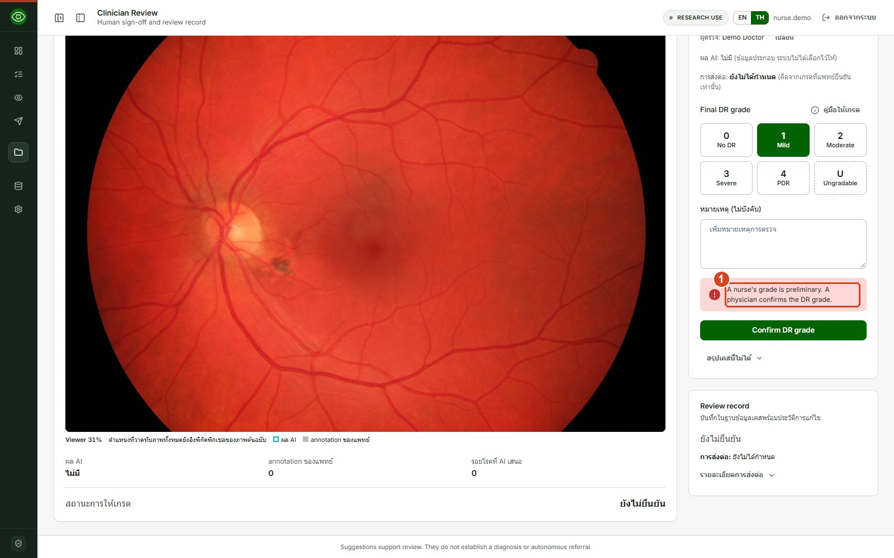

1. ข้อความแจ้งจากระบบ เกรดไม่ถูกบันทึก

ข้อความแจ้งเรื่องสิทธิ์จาก server ยังเป็นภาษาอังกฤษ เช่น "Only the administrator can change this." (เฉพาะผู้ดูแลระบบเปลี่ยนได้) และ "A researcher account can read and export, not change cases." (บัญชีนักวิจัยอ่านและส่งออกได้ แก้เคสไม่ได้)

## แก้ปัญหาเบื้องต้น

| อาการ | สาเหตุที่พบบ่อย | วิธีแก้ |
| --- | --- | --- |
| เข้าระบบไม่ได้ "The username or password is not correct." | พิมพ์ชื่อหรือรหัสผิด | ตรวจแป้น Caps Lock และภาษา ถ้าลืมรหัส ให้ผู้ดูแลระบบรีเซ็ต |
| "Too many attempts. Wait 5 minutes and try again." | ใส่รหัสผิดเกินจำนวนที่กำหนด | รอตามเวลาที่แจ้ง แล้วลองใหม่ |
| หลุดออกจากระบบเอง | ไม่ได้ใช้งานเกินเวลาที่กำหนด (ค่าเริ่มต้น 30 นาที) หรือมีการเปิดระบบใหม่ที่ server | เข้าระบบใหม่ งานที่บันทึกแล้วไม่หาย |
| แถบซ้ายขึ้น "เปิด Workspace ไม่ได้" หรือ Worklist ว่าง | ยังไม่มี Workspace หรือยังไม่ได้เปิด | ให้ผู้ดูแลระบบสร้างหรือเปิด Workspace แล้วกด **สแกนโฟลเดอร์นำเข้า** |
| ภาพใหม่ไม่ขึ้นใน Worklist | ภาพอยู่ในโฟลเดอร์ย่อย หรือนามสกุลไฟล์ไม่รองรับ | ย้ายภาพ (สำเนา) ไปไว้ชั้นบนสุดของ Input folder แล้วสแกนใหม่ |
| ป้าย "Image type needs confirmation" และ AI ไม่วิเคราะห์ | ยังไม่ได้ยืนยันชนิดภาพ | กด **Confirm Image** แล้วเลือก CFP หรือ UWF |
| "AI not available" หรือวิเคราะห์ไม่ได้ | ไม่ได้ตั้ง AI server, server ปิด, หรืออยู่นอกเวลา AI ของ server ทีม | ตรวจภาพเองต่อได้ แจ้งผู้ดูแลระบบให้กด **ทดสอบการเชื่อมต่อ** |
| "Case changed; reload" | มีคนอื่นแก้เคสเดียวกันระหว่างที่เปิดอยู่ | กดรีเฟรชหน้า แล้วทำต่อ ระบบไม่บันทึกทับงานของคนอื่น |
| ปุ่มลงนามรายงานกดไม่ได้ | บัญชีเป็นพยาบาล หรือยังไม่ได้เลือกผลคัดกรอง | ให้แพทย์ลงนาม และเลือก Refer, Not refer หรือ Ungradable ก่อน |
| browser เตือนเรื่องใบรับรอง (certificate) | ใบรับรอง HTTPS สร้างในเครื่องหรือใน server ของโรงพยาบาลเอง | ให้ฝ่าย IT ติดตั้งใบรับรองหลักในเครื่อง หรือกด Advanced แล้ว continue เฉพาะที่อยู่ที่ IT ยืนยันแล้ว |
| พิมพ์รายงานแล้วได้หน้าว่าง | browser บล็อกแท็บใหม่ | อนุญาต pop-up ของที่อยู่นี้ แล้วกด **พิมพ์ / บันทึกเป็น PDF** อีกครั้ง |

ถ้ายังแก้ไม่ได้ ให้จดเวลา หน้าที่ใช้ และข้อความที่ขึ้น แล้วแจ้งผู้ดูแลระบบ อย่าส่งภาพหน้าจอที่มีชื่อผู้ป่วยหรือ HN ทางแชท

## ข้อควรระวังด้านความปลอดภัย

- **ไม่ใช่เครื่องมือวินิจฉัย** ใช้เพื่อการวิจัยและช่วยคัดกรองเท่านั้น ยังไม่ได้รับการรับรองทางคลินิก
- **คนเป็นผู้ตัดสิน** เกรดและ annotation ที่คนยืนยันคือผลจริง ผล AI ที่มาทีหลังไม่เปลี่ยนเกรดที่ยืนยันแล้ว
- **ผล AI ที่ว่างไม่ได้แปลว่าไม่มีรอยโรค** และการกด Finish โดยไม่มีกรอบแปลว่า "ตรวจแล้ว" เท่านั้น
- **คะแนนของโมเดลไม่ใช่ความน่าจะเป็นทางคลินิก** ห้ามใช้คะแนนแทนการตัดสินใจของแพทย์
- **การส่งต่อ** ผู้ให้เกรดเลือก Refer หรือ Not refer เอง ระบบไม่ตัดสินแทน กฎอัตโนมัติมีข้อเดียวคือเกรด 4 ที่แพทย์ยืนยัน
- **ภาพที่ส่งไป server ทีม (dr-train)** ต้องเป็นภาพสาธารณะหรือภาพที่ได้รับ consent เท่านั้น งานกับภาพผู้ป่วยจริงต้องใช้ server ของโรงพยาบาล
- **ข้อมูลผู้ป่วย** ห้ามถ่ายภาพหน้าจอที่มีชื่อผู้ป่วยหรือ HN ส่งทางแชทหรืออีเมล ห้ามแชร์รหัสผ่าน และออกจากระบบทุกครั้งเมื่อใช้เครื่องร่วมกัน
- **ภาพต้นฉบับ** ระบบไม่แก้ ไม่ย้าย ไม่ลบภาพต้นฉบับ อย่าแก้ไฟล์ในโฟลเดอร์ Input เอง
